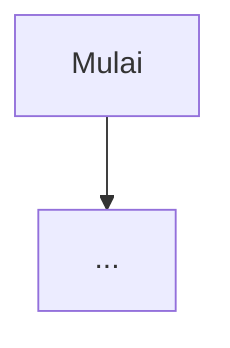

# Fitur: <nama fitur>

| | |
| --- | --- |
| **Domain** | |
| **Prioritas** | P0 / P1 / P2 |
| **Pemilik** | |
| **Status** | Draft / Disetujui / Dikerjakan / Selesai |
| **Referensi PRD** | Bagian ..., user story ... |
| **Flow doc** | `flows/<modul>.md` |

## 1. Ringkasan

Satu paragraf: masalah yang diselesaikan dan hasilnya bagi pengguna.

## 2. Aktor dan prasyarat

| Aktor | Boleh melakukan apa | Prasyarat |
| --- | --- | --- |
| | | |

## 3. Flow

Tautkan atau salin diagram dari flow doc. Jelaskan jalur sukses dan setiap cabang gagal.

## 4. Aturan bisnis

Daftar bernomor, masing-masing bisa diuji. Tandai [PRD], [USULAN], atau [OPEN].

1. 

## 5. Data

| Tabel / kolom | Perubahan | Catatan |
| --- | --- | --- |
| | | |

Migrasi berada di `app/Domains/<Domain>/Database/migrations`.

## 6. Antarmuka

| Jenis | Nama | Role | Catatan |
| --- | --- | --- | --- |
| Rute / Livewire / Command | | | |

Otorisasi: Policy dan ability yang dipakai.

## 7. Hubungan dengan domain lain

| Arah | Mekanisme (Contract / Event) | Nama |
| --- | --- | --- |
| Memanggil | | |
| Dipanggil / mendengar | | |

## 8. UI

Layar, komponen bersama yang dipakai, dan keadaan memuat, kosong, gagal. Tautkan desain bila ada.

## 9. Edge case

| ID | Situasi | Perilaku yang diharapkan |
| --- | --- | --- |
| `XXX-E1` | | |

## 10. Test case

Setiap baris menjadi satu test dengan ID yang sama di namanya.

- [ ] `XXX-T01` Jalur sukses ...
- [ ] `XXX-T02` Otorisasi: role ... ditolak
- [ ] `XXX-T03` Validasi: ...
- [ ] `XXX-T04` Edge case `XXX-E1`

## 11. Di luar cakupan

Yang sengaja tidak dikerjakan di fitur ini.

## 12. Pertanyaan terbuka

- [OPEN] 

## 13. Definition of Done

Lihat [CONTRIBUTING.md](../CONTRIBUTING.md#7-definition-of-done).
