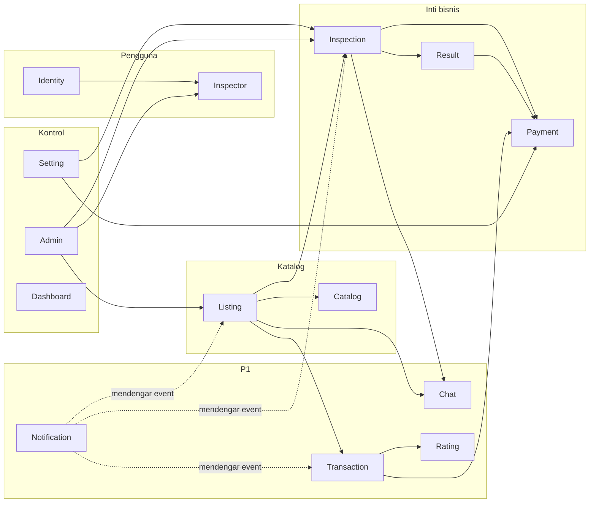
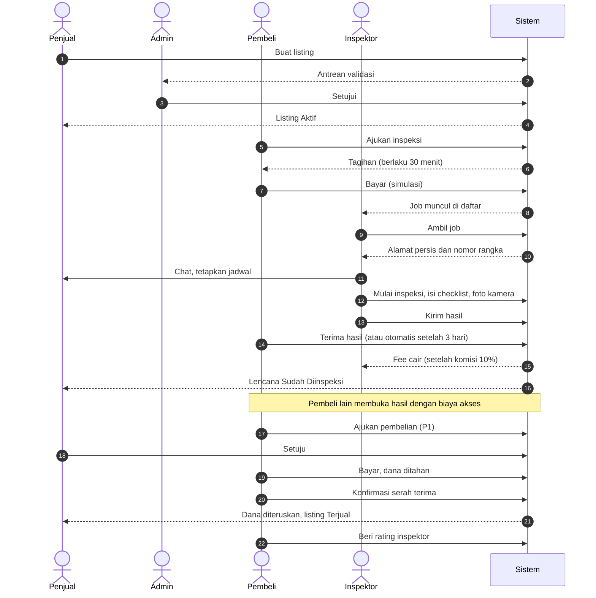

# Peta Flow

Dokumen ini menunjukkan seluruh modul, alur utama lintas role, dan hubungan antar-domain. Rincian ada di `flows/<modul>.md`.

Keputusan terbaru yang memengaruhi flow: [decisions/0002-flow-decisions.md](../decisions/0002-flow-decisions.md).

## 1. Peta modul

Panah penuh berarti "bergantung lewat Contract atau membaca Model". Panah putus-putus berarti mendengar event.

## 2. Alur utama end-to-end

## 3. Daftar flow per role

### Pengunjung (belum login)

| Flow | Modul |
| --- | --- |
| Melihat beranda, cara kerja, FAQ | Catalog |
| Cari dan filter listing, lihat detail publik | Catalog |
| Daftar akun pengguna atau inspektor, masuk, lupa password | Identity |

### Pembeli

| Flow | Modul |
| --- | --- |
| Cari dan lihat detail | Catalog |
| Ajukan inspeksi dan bayar | Inspection, Payment |
| Buka hasil inspeksi (bayar akses) | Result, Payment |
| Terima hasil inspeksi | Inspection |
| Chat dengan penjual | Chat |
| Ajukan pembelian, bayar, konfirmasi serah terima, batal | Transaction |
| Beri rating | Rating |
| Lihat notifikasi, riwayat, dashboard | Notification, Dashboard |

### Penjual

| Flow | Modul |
| --- | --- |
| Buat, edit, nonaktifkan listing, perbaiki yang ditolak | Listing |
| Ajukan inspeksi untuk listing sendiri | Inspection, Payment |
| Atur opsi waktu dan tempat inspeksi | Listing |
| Chat dengan inspektor dan pembeli | Chat |
| Setuju atau tolak pengajuan beli, batal | Transaction |
| Lihat hasil inspeksi listing sendiri | Result |

### Inspektor

| Flow | Modul |
| --- | --- |
| Daftar, unggah dokumen, tunggu verifikasi, ajukan ulang | Inspector |
| Lihat daftar job, ambil job, batalkan job | Inspection |
| Tetapkan jadwal, mulai inspeksi | Inspection, Chat |
| Isi form, simpan draf, foto kamera, kirim hasil | Result |
| Lihat pendapatan dan rating | Payment, Rating, Dashboard |

### Admin

| Flow | Modul |
| --- | --- |
| Validasi listing | Admin, Listing |
| Verifikasi inspektor | Admin, Inspector |
| Atur tarif, komisi, parameter waktu | Setting |
| Kelola template inspeksi | Admin, Result |
| Pantau, selesaikan, atau batalkan job dan transaksi manual | Admin, Inspection, Transaction |
| Blokir pengguna, sembunyikan rating | Admin, Identity, Rating |

### Sistem (terjadwal)

| Flow | Modul |
| --- | --- |
| Tagihan kedaluwarsa 30 menit | Inspection |
| Job `paid` 7 hari tidak diambil, batalkan dan refund | Inspection |
| Job `result_submitted` 3 hari, selesaikan otomatis | Inspection |
| Job belum dijadwalkan 48 jam, tandai perlu tindakan | Inspection |
| Penawaran beli kedaluwarsa | Transaction |

## 4. State machine

| Entitas | Modul | Status |
| --- | --- | --- |
| Listing | [listing](listing.md) | `pending_review`, `rejected`, `active`, `in_inspection`, `in_transaction`, `sold`, `inactive` |
| Job inspeksi | [job](job.md) | `requested`, `paid`, `taken`, `scheduled`, `in_progress`, `result_submitted`, `completed`, `cancelled`, `expired` |
| Pembayaran | [payment](payment.md) | `pending`, `success`, `failed`, `refunded` |
| Transaksi | [transaction](transaction.md) | `offered`, `accepted`, `paid_held`, `completed`, `rejected`, `cancelled`, `expired` |
| Verifikasi inspektor | [onboarding](onboarding.md) | `pending`, `approved`, `rejected` |
| Hasil inspeksi | [result](result.md) | `draft`, `submitted` |

## 5. Peta event antar-domain

Pemancar tidak tahu pendengarnya. Tabel ini menjadi acuan kontrak antar tim.

| Event | Pemancar | Pendengar dan reaksinya |
| --- | --- | --- |
| `ListingSubmitted` | Listing | Notification: antrean admin |
| `ListingApproved` / `ListingRejected` | Listing | Notification: penjual |
| `InspectorApproved` / `InspectorRejected` | Inspector | Notification: inspektor |
| `InspectionRequested` | Inspection | Listing: status `in_inspection` setelah dibayar. Notification |
| `PaymentSucceeded` (purpose `inspection`) | Payment | Inspection: job `paid`. Notification |
| `PaymentSucceeded` (purpose `access`) | Payment | Result: beri akses. Ledger memposting bagi hasil |
| `PaymentSucceeded` (purpose `purchase`) | Payment | Transaction: `paid_held`. Listing: `in_transaction` |
| `JobTaken` | Inspection | Chat: buat percakapan job. Notification |
| `JobScheduled`, `ResultSubmitted` | Inspection | Notification |
| `JobCompleted` | Inspection | Payment: posting fee inspektor dan komisi platform. Listing: `is_inspected`, kembali `active` |
| `JobCancelled` / `JobExpired` | Inspection | Payment: refund bila sudah dibayar. Listing: kembali `active` |
| `TransactionOffered/Accepted/Rejected` | Transaction | Notification |
| `TransactionCompleted` | Transaction | Listing: `sold`. Result: tutup akses baru. Payment: teruskan dana dan komisi. Rating: buka rating |
| `TransactionCancelled` | Transaction | Payment: refund. Listing: `active` |
| `MessageSent` | Chat | Notification: pesan baru |
| `RatingSubmitted` / `RatingHidden` | Rating | Inspector: hitung ulang rata-rata |
| `UserBlocked` | Identity | Listing: sembunyikan listing aktif |

## 6. Konvensi ID

| Prefiks | Modul |
| --- | --- |
| `AUTH` | Identity |
| `ONB` | Inspector |
| `LST` | Listing |
| `CAT` | Catalog |
| `JOB` | Inspection |
| `PAY` | Payment |
| `RES` | Result |
| `TRX` | Transaction |
| `CHT` | Chat |
| `RTG` | Rating |
| `NTF` | Notification |
| `ADM` | Admin dan Setting |
| `DSH` | Dashboard |

`-E<n>` = edge case, `-T<nn>` = test case, `-R<n>` = aturan bisnis.
