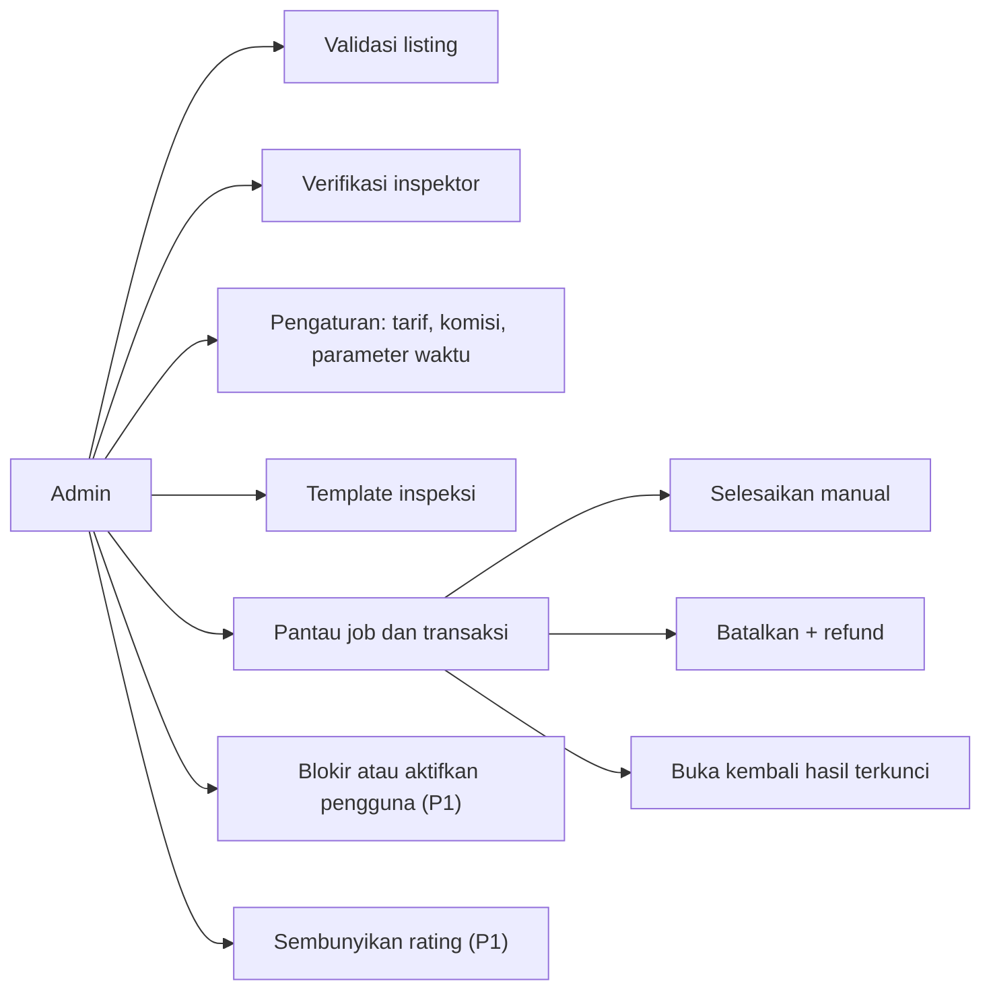
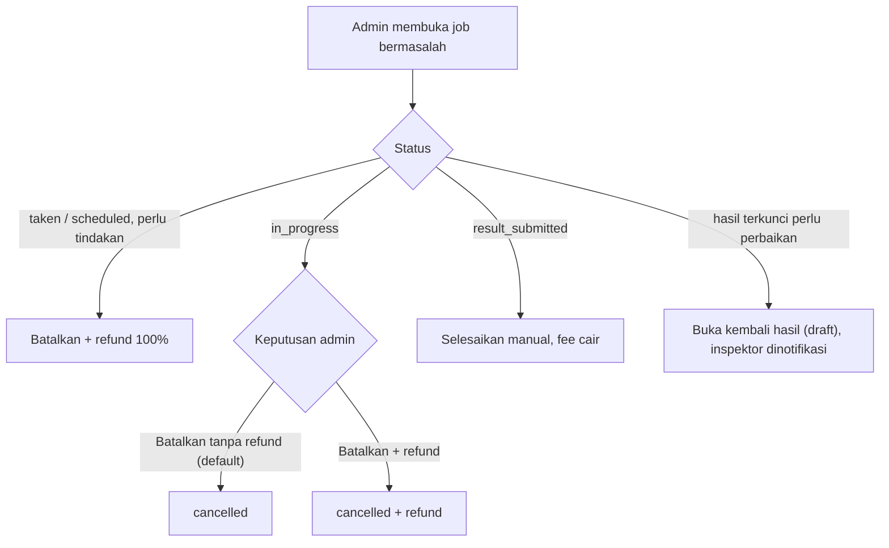

# Flow: Admin & Setting (ADM)

Prioritas P0 (kecuali dicatat). Referensi PRD: 9.4, 12.7, 12.8, 13.11, 18.17. Domain Admin **tipis**: ia memanggil Action domain lain, tidak punya aturan bisnis sendiri. Domain Setting menyimpan parameter.

## Aktor

Admin.

## 1. Peta aksi admin

## 2. Pengaturan

| Kunci | Default | Berlaku untuk |
| --- | --- | --- |
| `inspection_fee_car` | 50000 | Tarif inspeksi dan biaya akses mobil |
| `inspection_fee_motorcycle` | 15000 | Tarif inspeksi dan biaya akses motor |
| `platform_fee_pct` | 10 | Komisi platform dari tarif inspeksi dan biaya akses |
| `sale_commission_pct` | 3 | Komisi transaksi inspektor |
| `auto_accept_days` | 3 | Job `result_submitted` otomatis selesai (D-03) |
| `paid_job_timeout_days` | 7 | Job `paid` tidak diambil dibatalkan (D-01) |

Perubahan hanya berlaku untuk job dan transaksi **baru**. Nilai lama tersalin di job atau transaksi.

## 3. Aksi manual pada job

## 4. Aturan bisnis

| ID | Aturan |
| --- | --- |
| ADM-R1 | Seluruh rute admin dilindungi middleware role dan Policy |
| ADM-R2 | Aksi admin memakai Action domain pemilik. Tidak ada logika transisi di domain Admin |
| ADM-R3 | Persentase 0–100 bulat. Tarif bilangan bulat > 0. Hari ≥ 1 |
| ADM-R4 | Penolakan listing dan inspektor wajib alasan |
| ADM-R5 | Aksi admin pada status yang sudah berubah gagal tanpa efek (dua admin bersamaan) |
| ADM-R6 | Blokir pengguna dengan job atau transaksi aktif: admin menyelesaikan atau membatalkannya terlebih dulu atau bersamaan |
| ADM-R7 | Template inspeksi: tambah, ubah, urutkan item, tandai wajib, wajib foto, kritis. Perubahan menaikkan `version`. Hasil lama tetap memakai versi lama. Pada P0 template cukup di-*seed*, UI pada P1 |
| ADM-R8 | Aksi sensitif (blokir, batal manual, buka kembali hasil, ubah pengaturan) dicatat. Audit log lengkap P2 |
| ADM-R9 | Admin tidak dapat membuat dirinya diblokir atau mengubah rolenya sendiri |

## 5. Edge case

| ID | Situasi | Perilaku |
| --- | --- | --- |
| ADM-E1 | Admin mengubah tarif saat ada job berjalan | Job lama memakai tarif tersalin |
| ADM-E2 | Nilai pengaturan tidak valid (persen 150, tarif negatif) | Validasi gagal, tidak tersimpan sebagian |
| ADM-E3 | Dua admin memvalidasi listing atau memverifikasi inspektor yang sama | Yang kedua gagal dengan pesan status sudah berubah |
| ADM-E4 | Menyelesaikan manual job `result_submitted` dua kali | Fee cair sekali |
| ADM-E5 | Blokir pengguna dengan job/transaksi aktif | Ditolak sampai item diselesaikan, atau dibatalkan bersamaan dengan konfirmasi |
| ADM-E6 | Pengguna biasa atau inspektor mengakses rute admin | 403 |
| ADM-E7 | Template diubah saat inspektor sedang mengisi | Draf tetap pada versi lama (RES-E10) |
| ADM-E8 | Admin membatalkan job `in_progress` | Tanpa refund secara default, refund hanya bila dipilih eksplisit |
| ADM-E9 | Perubahan pengaturan tidak sengaja | Konfirmasi sebelum simpan, tercatat siapa dan kapan |

## 6. Daftar test case

- [x] `ADM-T01` Semua rute admin 403 untuk selain admin (dataset role)
- [x] `ADM-T02` Admin menyetujui dan menolak listing (alasan wajib), memanggil Action Listing
- [x] `ADM-T03` Admin memverifikasi inspektor, setujui dan tolak (alasan wajib)
- [x] `ADM-T04` Aksi ganda pada entitas yang sama berefek sekali (ADM-E3)
- [x] `ADM-T05` Ubah pengaturan valid tersimpan, tidak valid ditolak seluruhnya (ADM-E2)
- [x] `ADM-T06` Perubahan pengaturan hanya memengaruhi job dan transaksi baru (ADM-E1)
- [ ] `ADM-T07` Selesaikan manual job `result_submitted`: fee cair sekali (ADM-E4)
- [ ] `ADM-T08` Batalkan job per status dan opsi refund (ADM-E8), dataset
- [ ] `ADM-T09` Buka kembali hasil: status `draft`, inspektor dinotifikasi
- [ ] `ADM-T10` Blokir pengguna: ditolak bila ada item aktif, sukses bersamaan dengan pembatalan terkonfirmasi (ADM-E5)
- [ ] `ADM-T11` Admin tidak dapat memblokir atau mengubah role dirinya sendiri (ADM-R9)
- [ ] `ADM-T12` Template: ubah menaikkan versi, hasil lama tidak berubah (ADM-E7)
- [ ] `ADM-T13` Aksi sensitif tercatat
