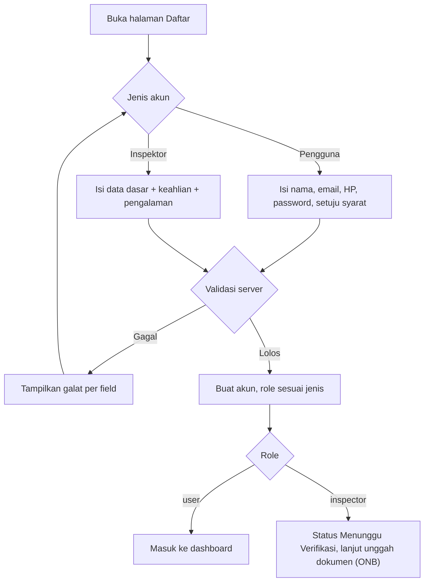
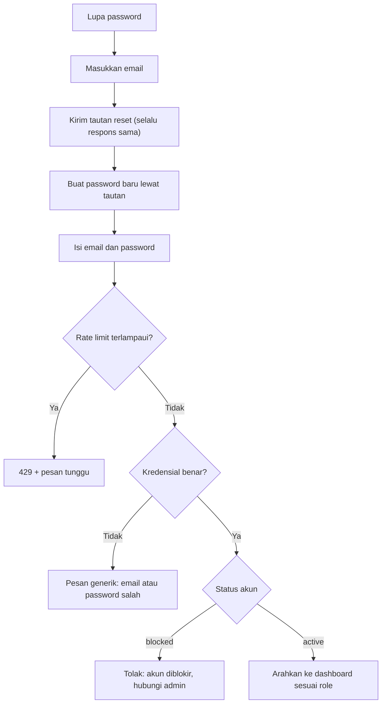

# Flow: Identity (AUTH)

Prioritas P0. Referensi PRD: 10, 12.1, 13.1, 13.10, 17.

## Aktor

Pengunjung, pengguna (pembeli/penjual), inspektor, admin.

## 1. Registrasi

## 2. Login, logout, lupa password

## 3. Aturan bisnis

| ID | Aturan |
| --- | --- |
| AUTH-R1 | Role `user` dapat menjadi pembeli sekaligus penjual |
| AUTH-R2 | Role `inspector` hanya bisa dibuat lewat pendaftaran inspektor, lalu diverifikasi admin |
| AUTH-R3 | Role `admin` hanya dari seeder, tidak ada rute pendaftaran |
| AUTH-R4 | Email unik. Nomor HP format Indonesia (08… atau +62…, 9–14 digit) |
| AUTH-R5 | Password minimal 8 karakter, kombinasi huruf dan angka |
| AUTH-R6 | Pesan login gagal generik. Respons lupa password selalu sama, ada atau tidak emailnya |
| AUTH-R7 | Sesi berakhir setelah 7 hari tidak aktif [USULAN] |
| AUTH-R8 | Verifikasi email dimatikan pada P0 [OPEN] |
| AUTH-R9 | Persetujuan syarat ketentuan dicatat di `accepted_terms_at` (P1) |
| AUTH-R10 | Inspektor tidak dapat mengajukan inspeksi, membeli, atau menjual (D-06, [OPEN]) |

## 4. Edge case

| ID | Situasi | Perilaku |
| --- | --- | --- |
| AUTH-E1 | Email sudah terdaftar | Pesan "email sudah terdaftar" dengan tautan masuk dan reset |
| AUTH-E2 | Mencoba mendaftar sebagai admin (manipulasi form) | Field `role` diabaikan, akun dibuat sebagai `user` |
| AUTH-E3 | Terlalu banyak percobaan login, registrasi, atau reset | 429 dengan pesan tunggu, tanpa membocorkan akun mana yang valid |
| AUTH-E4 | Pengguna diblokir saat sedang login | Sesi berikutnya ditolak, diarahkan ke halaman akun diblokir |
| AUTH-E5 | Sesi berakhir saat mengisi form | Diminta masuk ulang. Draf form inspeksi dipulihkan (RES) |
| AUTH-E6 | Tautan reset kedaluwarsa atau sudah dipakai | Pesan jelas dan opsi minta tautan baru |
| AUTH-E7 | Blokir pengguna yang punya job atau transaksi aktif | Admin harus menyelesaikan atau membatalkan item itu dulu atau bersamaan (ADM) |
| AUTH-E8 | Inspektor mengakses halaman pembeli/penjual | 403 |
| AUTH-E9 | Satu akun dipakai di banyak perangkat | Diizinkan |
| AUTH-E10 | Ganti password | Sesi perangkat lain tetap, kecuali sesi saat ini (logout semua perangkat = P2) |

## 5. Daftar test case

- [x] `AUTH-T01` Pengguna mendaftar dengan data valid dan masuk ke dashboard
- [x] `AUTH-T02` Email dan HP tidak valid ditolak dengan galat per field (dataset)
- [x] `AUTH-T03` Password lemah ditolak (dataset)
- [x] `AUTH-T04` Inspektor mendaftar berstatus `pending` (bagian "tidak bisa membuka daftar job" ditunda hingga kartu JOB-2)
- [x] `AUTH-T05` Pendaftaran tidak bisa menghasilkan role `admin` (AUTH-E2)
- [x] `AUTH-T06` Email duplikat ditolak (AUTH-E1)
- [x] `AUTH-T07` Login gagal tidak membedakan email atau password salah
- [x] `AUTH-T08` Rate limit login dan lupa password (AUTH-E3)
- [x] `AUTH-T09` Pengguna `blocked` tidak bisa login dan sesi aktifnya ditolak (AUTH-E4)
- [x] `AUTH-T10` Alur reset password sukses, tautan kedaluwarsa ditolak (AUTH-E6)
- [x] `AUTH-T11` Dashboard mengarah sesuai role (dashboard sementara [USULAN] disediakan oleh Identity hingga kartu DSH-1)
- [x] `AUTH-T12` Setiap role mengakses rute role lain mendapat 403 (dataset role × rute)
- [ ] `AUTH-T13` Ubah profil dan ganti password
- [x] `AUTH-T14` Seeder membuat admin dan admin tidak bisa dibuat dari rute publik
