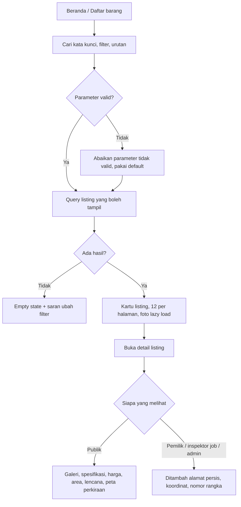

# Flow: Catalog (CAT)

Prioritas P0, baca saja. Referensi PRD: 9.1, 13.2, 20.1.

## Aktor

Pengunjung, pembeli, penjual, inspektor, admin.

## 1. Pencarian dan detail

## 2. Aturan bisnis

| ID | Aturan |
| --- | --- |
| CAT-R1 | Daftar publik hanya listing berstatus `active`, `in_inspection`, atau `in_transaction` |
| CAT-R2 | Filter: kata kunci, jenis, merek, rentang harga, rentang tahun, area, status inspeksi |
| CAT-R3 | Urutan: terbaru (default), harga termurah, harga termahal, kilometer terendah |
| CAT-R4 | 12 kartu per halaman, thumbnail di daftar, foto penuh di detail |
| CAT-R5 | Peta detail hanya perkiraan area, tanpa penanda persis |
| CAT-R6 | Domain Catalog tidak menulis data apa pun |
| CAT-R7 | Detail privat memakai Resource terpisah yang diotorisasi Policy |

## 3. Matriks tombol aksi di detail listing

| Tombol | Syarat |
| --- | --- |
| **Ajukan Inspeksi** | Login, role `user`, listing `active`, tanpa job aktif, bukan hasil yang sudah ada untuk pemohon |
| **Lihat Hasil Inspeksi** | Listing berlencana. Jika belum berhak: **Buka Hasil** dengan biaya akses |
| **Chat Penjual** | Login, role `user`, bukan pemilik (P1) |
| **Ajukan Pembelian** | Login, role `user`, bukan pemilik, listing `active` atau `in_inspection`, tanpa transaksi berjalan (P1, D-02) |
| **Edit / Nonaktifkan** | Pemilik, sesuai LST-R6 dan LST-R7 |
| Tanpa tombol | Listing `sold`, atau pengunjung (diarahkan ke login) |

## 4. Edge case

| ID | Situasi | Perilaku |
| --- | --- | --- |
| CAT-E1 | Tidak ada hasil | Empty state dengan tombol hapus filter |
| CAT-E2 | Parameter tidak valid (`page=abc`, `price_min=-1`, `sort=hack`) | Diabaikan atau dikoreksi ke default, tidak error 500 |
| CAT-E3 | Halaman melebihi total | Arahkan ke halaman terakhir atau tampilkan kosong yang ramah |
| CAT-E4 | Listing non-publik diakses lewat URL | 404 untuk selain pemilik dan admin |
| CAT-E5 | Listing `sold` | Tampil sebagai Terjual tanpa tombol aksi, tidak ada di daftar |
| CAT-E6 | Pengunjung menekan tombol yang butuh login | Arahkan ke login, lalu kembali ke listing |
| CAT-E7 | Pencarian dengan karakter khusus atau sangat panjang | Dibersihkan, tidak merusak query |
| CAT-E8 | Banyak listing dan foto | Pagination, eager load, tanpa N+1 |
| CAT-E9 | Lencana berlaku tetapi hasil lama (D-05 mencabut) | Lencana tidak tampil |

## 5. Daftar test case

- [ ] `CAT-T01` Daftar hanya memuat status yang diperbolehkan (CAT-R1), dataset semua status
- [ ] `CAT-T02` Setiap filter bekerja dan dapat digabung (dataset)
- [ ] `CAT-T03` Setiap urutan menghasilkan urutan yang benar
- [ ] `CAT-T04` Pagination 12 per halaman dan total benar
- [ ] `CAT-T05` Parameter tidak valid tidak menyebabkan error (CAT-E2), dataset
- [ ] `CAT-T06` Respons publik tidak memuat `lat`, `lng`, `address_full`, `chassis_number`
- [ ] `CAT-T07` Pemilik, inspektor job, dan admin melihat data persis. Role lain tidak (dataset)
- [ ] `CAT-T08` Listing non-publik 404 untuk publik (CAT-E4)
- [ ] `CAT-T09` Matriks tombol aksi sesuai peran dan status (dataset peran × status)
- [ ] `CAT-T10` Empty state tampil saat tidak ada hasil
- [ ] `CAT-T11` Jumlah query pada daftar tidak bertambah seiring jumlah item (tanpa N+1)
- [ ] `CAT-T12` Lencana tidak tampil pada listing yang dicabut (CAT-E9)
