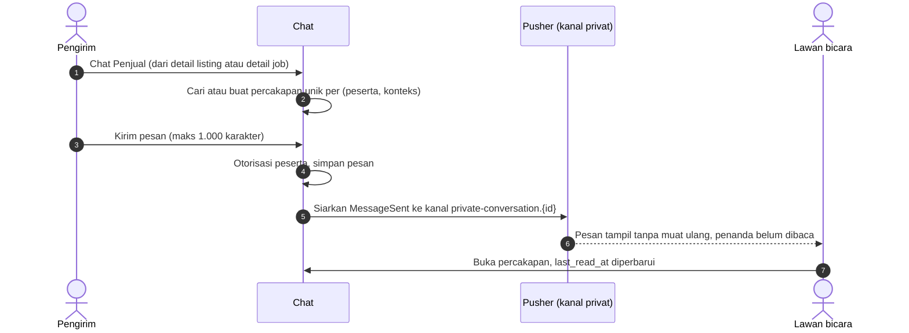
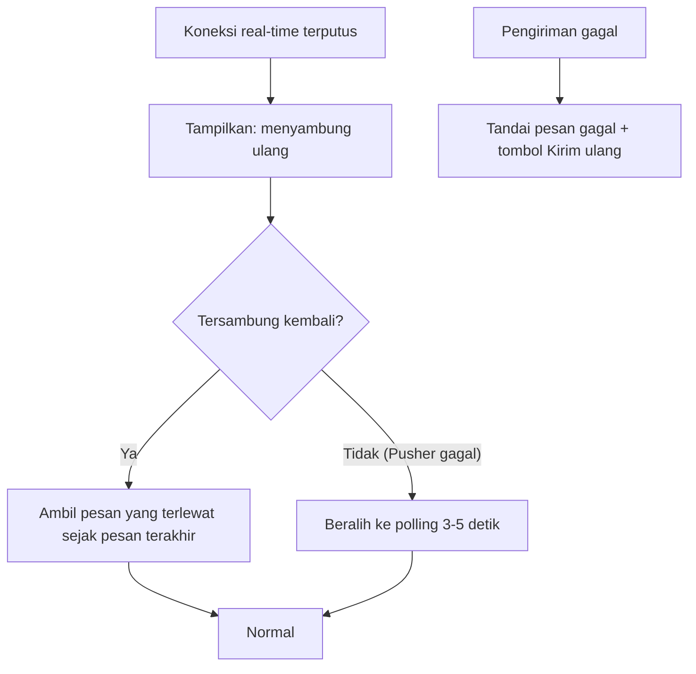

# Flow: Chat (CHT)

Prioritas P1. Referensi PRD: 12.6, 13.13, 18.14, 22 (E21, E22). Real-time lewat Laravel Echo + Pusher, cadangan polling Livewire.

## Aktor

Pembeli, penjual, inspektor.

## 1. Alur

## 2. Koneksi putus dan cadangan

## 3. Aturan bisnis

| ID | Aturan |
| --- | --- |
| CHT-R1 | Percakapan unik per pasangan peserta dan konteks (`listing` atau `job`) |
| CHT-R2 | Konteks `listing`: pembeli–penjual. Konteks `job`: inspektor–penjual (dibuat saat `JobTaken`) |
| CHT-R3 | Hanya peserta yang dapat membaca dan mengirim. Kanal privat dengan otorisasi |
| CHT-R4 | Pesan teks saja, maks 1.000 karakter, teks pengguna di-*escape* |
| CHT-R5 | Tidak ada unggah berkas atau gambar |
| CHT-R6 | Pengguna diblokir tidak dapat mengirim pesan |
| CHT-R7 | Target tampil di lawan bicara < 2 detik dengan Pusher |
| CHT-R8 | Pengguna tidak dapat memulai percakapan dengan dirinya sendiri |
| CHT-R9 | Pembatasan laju kirim pesan per pengguna [USULAN: 30 pesan per menit] |

## 4. Edge case

| ID | Situasi | Perilaku |
| --- | --- | --- |
| CHT-E1 | Koneksi real-time terputus | Indikator "menyambung ulang", sambung otomatis, pesan terlewat diambil |
| CHT-E2 | Lawan bicara tidak membuka aplikasi | Pesan tersimpan, tampil dengan penanda belum dibaca |
| CHT-E3 | Pengguna bukan peserta mencoba berlangganan kanal atau membaca | 403 |
| CHT-E4 | Pesan kosong atau > 1.000 karakter | Validasi gagal |
| CHT-E5 | Pesan berisi HTML atau skrip | Di-*escape*, tampil sebagai teks |
| CHT-E6 | Kirim ganda (klik dua kali) | Satu pesan (kunci klien unik per pesan) |
| CHT-E7 | Pusher tidak tersedia | Polling mengambil alih, fitur tetap berfungsi |
| CHT-E8 | Memulai chat dengan listing sendiri | Ditolak |
| CHT-E9 | Percakapan konteks sama dimulai dua kali | Memakai percakapan yang ada |
| CHT-E10 | Pesan gagal terkirim | Ditandai dan dapat dikirim ulang tanpa duplikat |

## 5. Daftar test case

- [x] `CHT-T01` Memulai chat membuat percakapan, kedua kali memakai yang sama (CHT-E9)
- [x] `CHT-T02` Kirim pesan tersimpan dan `MessageSent` dipancarkan ke kanal yang benar
- [x] `CHT-T03` Otorisasi kanal: peserta diizinkan, selain itu ditolak (CHT-E3), dataset role
- [x] `CHT-T04` Validasi panjang dan kosong (CHT-E4)
- [x] `CHT-T05` HTML di-*escape* (CHT-E5)
- [x] `CHT-T06` Belum dibaca bertambah untuk lawan bicara dan nol setelah dibuka (`last_read_at`)
- [x] `CHT-T07` Ambil pesan setelah pesan terakhir mengembalikan yang terlewat (CHT-E1)
- [x] `CHT-T08` Kirim ganda dengan kunci sama menjadi satu pesan (CHT-E6)
- [x] `CHT-T09` Chat dengan diri sendiri ditolak (CHT-E8)
- [x] `CHT-T10` Pengguna diblokir tidak dapat mengirim (CHT-R6)
- [x] `CHT-T11` Polling mengembalikan pesan baru tanpa Pusher (CHT-E7)
- [x] `CHT-T12` Pembatasan laju (CHT-R9)
- [x] `CHT-T13` Percakapan job dibuat saat `JobTaken` dengan peserta inspektor dan penjual
