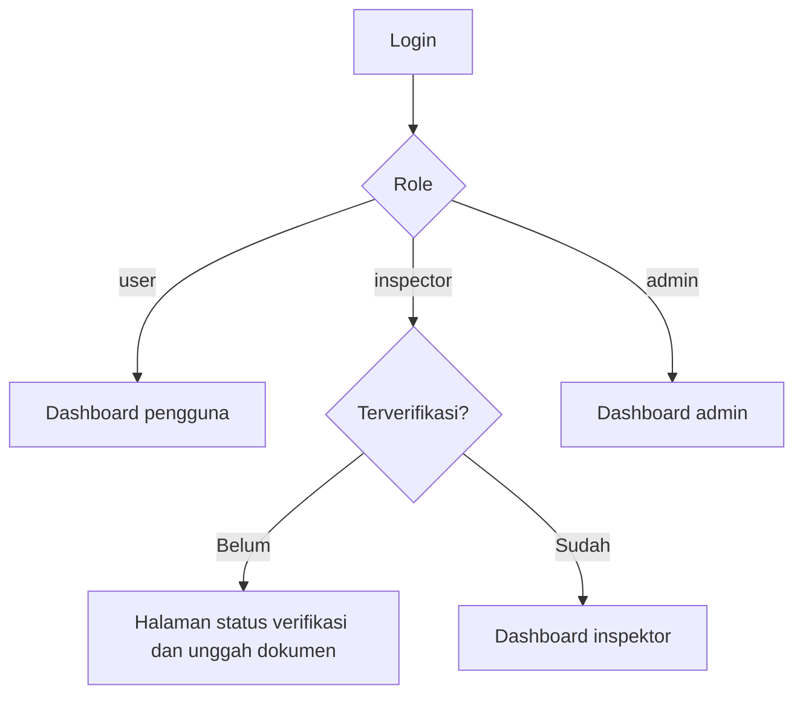

# Flow: Dashboard (DSH)

Prioritas P0, baca saja. Referensi PRD: 13.8, 9.2–9.4. Cukup kartu angka dan daftar singkat, grafik tidak wajib pada P0.

## Aktor

Pembeli/penjual, inspektor, admin.

## 1. Alur

## 2. Isi per role

| Role | Kartu | Daftar |
| --- | --- | --- |
| Pembeli | Inspeksi berjalan, hasil yang bisa diakses, transaksi aktif (P1) | Inspeksi terakhir, riwayat akses |
| Penjual | Listing menurut status, status inspeksi per listing, pengajuan beli menunggu (P1) | Listing saya, tindakan yang perlu dilakukan |
| Inspektor | Job tersedia, job aktif, pendapatan bersih, rating, jumlah inspeksi | Job saya, aktivitas terbaru |
| Admin | Pengguna, job per status, pendapatan platform, antrean listing, antrean inspektor, item perlu tindakan | Antrean dan item bermasalah |

Satu akun `user` yang menjadi pembeli sekaligus penjual melihat kedua bagian dalam satu dashboard.

## 3. Aturan bisnis

| ID | Aturan |
| --- | --- |
| DSH-R1 | Dashboard hanya membaca data milik pengguna (atau seluruh platform bagi admin) |
| DSH-R2 | Angka berasal dari sumber yang sama dengan halaman rinci (ledger, status job), tidak dihitung ganda dengan rumus berbeda |
| DSH-R3 | Pendapatan inspektor = jumlah entri ledger kreditnya |
| DSH-R4 | Tanpa data persis (alamat, koordinat, nomor rangka) pada kartu |
| DSH-R5 | Query ringan: *eager load*, agregat di database, cache singkat untuk admin bila perlu |
| DSH-R6 | Setiap kartu punya empty state yang jelas dan tautan ke tindakan berikutnya |

## 4. Edge case

| ID | Situasi | Perilaku |
| --- | --- | --- |
| DSH-E1 | Pengguna baru tanpa data | Empty state dengan ajakan (Tambah Barang, Cari Kendaraan) |
| DSH-E2 | Inspektor belum diverifikasi | Diarahkan ke halaman status, bukan dashboard kosong |
| DSH-E3 | Angka dashboard berbeda dari halaman rinci | Dianggap bug (DSH-R2) |
| DSH-E4 | Data besar pada admin | Agregat di database, tanpa memuat seluruh baris |
| DSH-E5 | Satu sumber gagal dimuat | Kartu itu menampilkan galat dengan **Coba lagi**, kartu lain tetap tampil |
| DSH-E6 | Pengguna mengakses dashboard role lain | 403 atau diarahkan ke dashboard miliknya |

## 5. Daftar test case

- [x] `DSH-T01` Setiap role melihat kartu sesuai tabel
- [x] `DSH-T02` Pengguna hanya melihat data miliknya (DSH-R1), dataset dua pengguna
- [x] `DSH-T03` Pendapatan inspektor sama dengan jumlah ledger (DSH-R3)
- [x] `DSH-T04` Angka admin sesuai data (job per status, antrean)
- [x] `DSH-T05` Empty state untuk pengguna baru (DSH-E1)
- [x] `DSH-T06` Inspektor belum diverifikasi diarahkan ke halaman status (DSH-E2)
- [x] `DSH-T07` Jumlah query tidak bertambah seiring data (DSH-E4)
- [x] `DSH-T08` Kegagalan satu kartu tidak merusak halaman (DSH-E5)
- [x] `DSH-T09` Respons tidak memuat data persis (DSH-R4)
