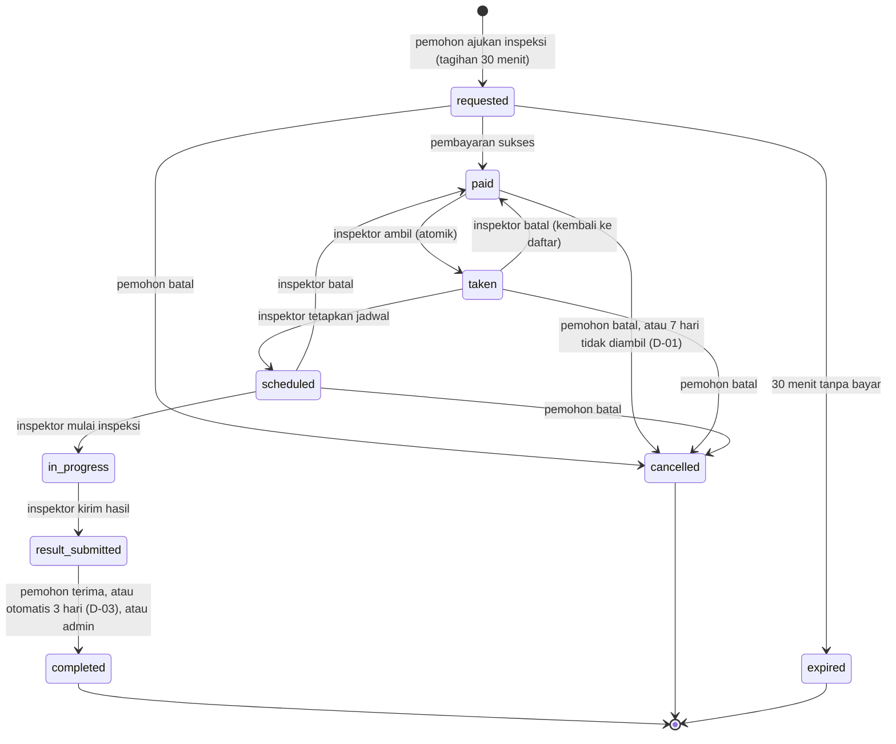
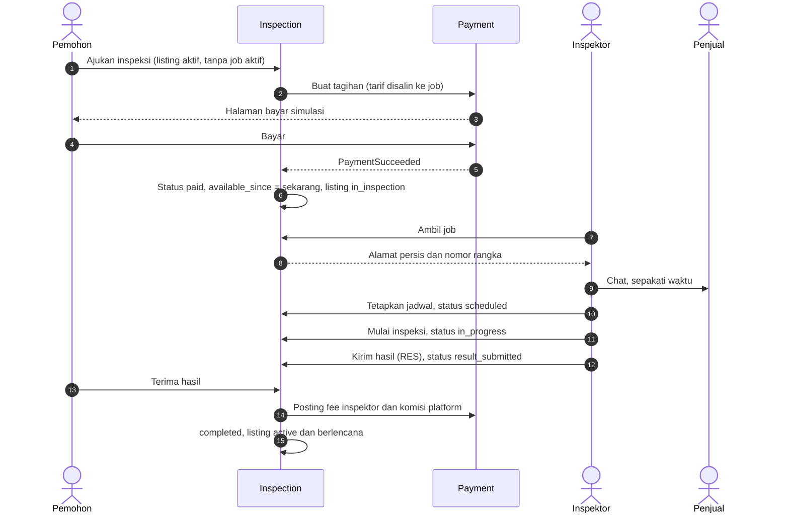

# Flow: Inspection Job (JOB)

Prioritas P0. Referensi PRD: 8.3, 8.4, 8.5, 12.3, 13.4, 13.5, 14.2, 18.7, 22. Keputusan: D-01, D-03.

## Aktor

Pemohon (pembeli atau penjual), inspektor, admin, sistem (terjadwal).

## 1. State machine

Status akhir: `completed`, `cancelled`, `expired`. Job aktif = bukan status akhir. Setelah `in_progress`, hanya admin yang dapat membatalkan.

## 2. Alur utama

## 3. Pembatalan dan refund

| Status saat batal | Siapa | Boleh | Dana | Efek |
| --- | --- | --- | --- | --- |
| `requested` | Pemohon | Ya | - (belum bayar) | `cancelled` |
| `paid` | Pemohon | Ya | Refund 100% | `cancelled`, listing `active` |
| `taken`, `scheduled` | Pemohon | Ya | Refund 100% | `cancelled`, listing `active`, inspektor dinotifikasi |
| `taken`, `scheduled` | Inspektor | Ya | Dana tetap ditahan | Kembali `paid`, `inspector_id` dikosongkan, dicatat untuk tinjauan admin |
| `in_progress` | Pemohon | **Tidak** | - | Hanya admin |
| `in_progress` | Admin | Ya | Tidak ada refund secara default, admin dapat memilih | `cancelled` |
| `result_submitted` | Pemohon | Tidak, harus Terima | - | Admin dapat menyelesaikan atau membatalkan |
| `paid` > 7 hari | Sistem | Otomatis | Refund 100% | `cancelled`, listing `active`, notifikasi (D-01) |
| `result_submitted` > 3 hari | Sistem | Otomatis selesai | Fee cair | `completed` (D-03) |

## 4. Aturan bisnis

| ID | Aturan |
| --- | --- |
| JOB-R1 | Satu listing hanya satu job aktif. Dijaga indeks unik pada kolom virtual `active_listing_id` dan Action |
| JOB-R2 | Satu job hanya satu inspektor. Ambil job atomik (pembaruan berkondisi `status = paid AND inspector_id IS NULL`) |
| JOB-R3 | Inspektor hanya `approved`, sesuai jenis keahlian, dan maksimal 3 job aktif bersamaan [USULAN] |
| JOB-R4 | Inspektor tidak dapat mengambil job atas listing miliknya (`403 OWN_LISTING`) |
| JOB-R5 | Alamat persis dan nomor rangka hanya dikirim ke inspektor pengambil setelah `taken` |
| JOB-R6 | Tarif, `platform_fee_pct`, dan `expires_at` disalin ke job saat dibuat |
| JOB-R7 | Tagihan `requested` berlaku 30 menit, lalu `expired` dan listing dapat diajukan inspeksi lagi |
| JOB-R8 | Job `paid` yang tidak diambil dalam 7 hari sejak `available_since` otomatis dibatalkan dan direfund (D-01) |
| JOB-R9 | Job `result_submitted` otomatis `completed` setelah `auto_accept_days` (3) hari (D-03) |
| JOB-R10 | Job yang jadwalnya belum ditetapkan 48 jam setelah `taken` ditandai `needs_attention_at` |
| JOB-R11 | Hanya perubahan status lewat Action dan transisi sah di Enum. Setiap transisi mencatat waktunya |
| JOB-R12 | Pemohon tidak boleh inspektor. Inspektor tidak dapat mengajukan inspeksi (D-06) |
| JOB-R13 | Pembayaran beli (TRX) tidak dibuka selama ada job aktif (D-02) |

## 5. Edge case

| ID | Situasi | Perilaku |
| --- | --- | --- |
| JOB-E1 | Dua inspektor menekan Ambil Job bersamaan | Hanya satu berhasil, yang lain `409 JOB_ALREADY_TAKEN` dan daftar diperbarui |
| JOB-E2 | Dua pemohon mengajukan inspeksi pada listing yang sama | Indeks unik: yang kedua `409 LISTING_HAS_ACTIVE_JOB` |
| JOB-E3 | Inspektor membatalkan setelah mengambil | Job kembali `paid`, `available_since` dihitung ulang, dicatat |
| JOB-E4 | Penjual tidak responsif, jadwal tidak ditetapkan | Setelah 48 jam ditandai perlu tindakan. Admin dapat membatalkan dan refund |
| JOB-E5 | Inspektor mencoba job listing sendiri | `403 OWN_LISTING`, job tidak tampil di daftarnya |
| JOB-E6 | Inspektor mencapai batas 3 job aktif | `409 MAX_ACTIVE_JOBS` |
| JOB-E7 | Inspektor belum diverifikasi | `403 INSPECTOR_NOT_VERIFIED` |
| JOB-E8 | Pemohon batal tepat saat inspektor menekan Ambil | Salah satu menang. Yang kalah menerima konflik, tanpa status ganda |
| JOB-E9 | Penjual menonaktifkan listing saat job aktif | Ditolak (LST-E4) |
| JOB-E10 | Mulai inspeksi sebelum dijadwalkan | Ditolak, status tidak sah |
| JOB-E11 | Job dibatalkan setelah dibayar | Refund tercatat di ledger sekali saja (idempoten) |
| JOB-E12 | Scheduler dijalankan dua kali | Tidak ada refund atau penyelesaian ganda |
| JOB-E13 | Tarif diubah admin saat job berjalan | Job memakai tarif yang disalin |
| JOB-E14 | Listing terjual atau diblokir saat job berjalan | Admin menangani. Sistem tidak membatalkan diam-diam |
| JOB-E15 | Pemohon menekan Terima Hasil dua kali | Efek sekali (idempoten) |
| JOB-E16 | Penghitung 7 hari setelah inspektor membatalkan | Dihitung ulang dari saat kembali `paid` |
| JOB-E17 | Pemohon hendak membatalkan saat `in_progress` | Ditolak, hanya admin |

## 6. Daftar test case

- [x] `JOB-T01` Ajukan inspeksi membuat job `requested` dengan tarif sesuai jenis kendaraan
- [x] `JOB-T02` Ajukan inspeksi hanya pada listing `active` tanpa job aktif (JOB-E2), dataset status
- [x] `JOB-T03` Hanya satu inspektor dapat mengambil job (JOB-E1)
- [x] `JOB-T04` Indeks unik menolak job aktif kedua langsung lewat query (JOB-R1)
- [x] `JOB-T05` Ambil job ditolak: tidak terverifikasi, listing sendiri, batas 3 job, jenis keahlian tidak cocok (dataset)
- [x] `JOB-T06` Alamat persis dan nomor rangka hanya muncul setelah `taken` untuk inspektor pengambil (JOB-R5)
- [x] `JOB-T07` Inspektor batal: kembali `paid`, `inspector_id` null, `available_since` baru (JOB-E3, JOB-E16)
- [x] `JOB-T08` Setiap transisi sah diterima dan tidak sah ditolak (dataset)
- [ ] `JOB-T09` Tagihan kedaluwarsa tepat di 30 menit (29 menit belum, 31 menit sudah)
- [ ] `JOB-T10` Job `paid` 7 hari: refund dan listing `active` (6 hari belum, 7 hari sudah), idempoten (JOB-R8, JOB-E12)
- [ ] `JOB-T11` Job `result_submitted` 3 hari: `completed` dan fee cair (JOB-R9), idempoten
- [ ] `JOB-T12` Job `taken` tanpa jadwal 48 jam ditandai `needs_attention_at` (JOB-R10)
- [x] `JOB-T13` Pembatalan pemohon per status: refund atau ditolak sesuai tabel bagian 3 (dataset)
- [x] `JOB-T14` Pemohon tidak dapat membatalkan saat `in_progress`, admin dapat (JOB-E17)
- [ ] `JOB-T15` Terima Hasil memposting ledger sekali, ganda tidak berefek (JOB-E15)
- [x] `JOB-T16` Perubahan tarif tidak memengaruhi job lama (JOB-E13)
- [x] `JOB-T17` Inspektor tidak dapat mengajukan inspeksi (JOB-R12)
- [x] `JOB-T18` Aksi tiap role pada job milik orang lain mendapat 403 (dataset role × aksi)
- [ ] `JOB-T19` Event dipancarkan: `JobTaken`, `JobScheduled`, `ResultSubmitted`, `JobCompleted`, `JobCancelled`, `JobExpired`
