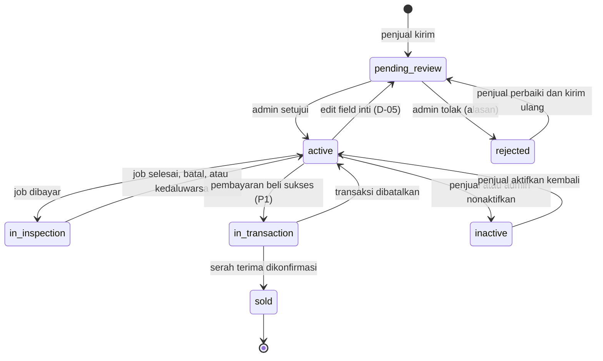
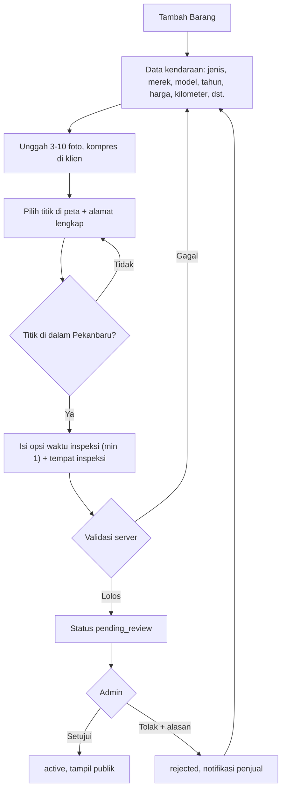
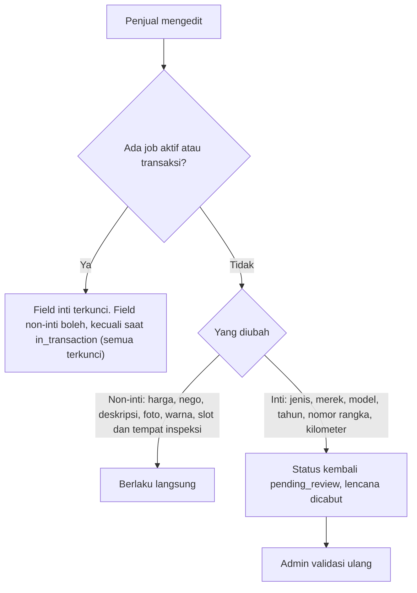

# Flow: Listing (LST)

Prioritas P0. Referensi PRD: 12.2, 12.8, 13.3, 14.1, 16, 18.4–18.6. Keputusan: D-05 (edit), D-02 (beli saat inspeksi).

## Aktor

Penjual (pemilik), admin.

## 1. State machine

Catatan: pembayaran beli tidak dapat terjadi saat `in_inspection` (D-02). Pembeli bisa mengajukan dan penjual menyetujui, tetapi pembayaran menunggu job aktif selesai.

## 2. Membuat listing

## 3. Mengedit listing aktif (D-05)

## 4. Aturan bisnis

| ID | Aturan |
| --- | --- |
| LST-R1 | Listing baru `pending_review`, tidak tampil publik |
| LST-R2 | Foto 3–10, maks 2 MB per foto, JPG/PNG/WebP. Satu foto ditandai sampul |
| LST-R3 | Titik lokasi harus di dalam wilayah Pekanbaru, divalidasi di server |
| LST-R4 | Lokasi persis, alamat lengkap, dan nomor rangka tidak pernah di respons publik |
| LST-R5 | Opsi waktu inspeksi minimal 1 dan tidak di masa lalu |
| LST-R6 | Penjual tidak dapat menghapus atau menonaktifkan listing yang punya job aktif atau transaksi |
| LST-R7 | Edit mengikuti D-05. Field inti terkunci saat ada job aktif atau transaksi |
| LST-R8 | Listing `sold` tidak dapat diubah |
| LST-R9 | Pengguna yang diblokir: listing aktifnya otomatis `inactive` [USULAN] |
| LST-R10 | Perubahan status hanya lewat Action domain Listing, dipicu event dari domain lain |

## 5. Edge case

| ID | Situasi | Perilaku |
| --- | --- | --- |
| LST-E1 | Pin di luar Pekanbaru | Ditolak, pesan jelas |
| LST-E2 | Foto > 2 MB atau bukan gambar | Dikompresi di klien, bila tetap gagal pesan jelas |
| LST-E3 | Foto kurang dari 3 atau lebih dari 10 | Validasi gagal |
| LST-E4 | Menonaktifkan atau menghapus listing saat ada job aktif | Ditolak, penjual diminta membatalkan job dulu |
| LST-E5 | Edit field inti setelah diinspeksi | Lencana dicabut, `pending_review` |
| LST-E6 | Penjual mengubah harga saat ada penawaran beli berjalan | Penawaran memakai harga yang disalin saat diajukan, penjual diberi peringatan |
| LST-E7 | Listing ditolak, penjual mengirim ulang tanpa perubahan | Diperbolehkan, kembali ke antrean |
| LST-E8 | Dua admin memvalidasi listing yang sama | Aksi kedua gagal karena status sudah berubah |
| LST-E9 | Pengguna lain mengedit listing | 403 |
| LST-E10 | Akses `GET /listings/{id}` untuk listing non-publik oleh bukan pemilik/admin | 404 |
| LST-E11 | Listing `sold` dibuka | Tampil sebagai Terjual, tanpa tombol aksi |
| LST-E12 | Lencana dicabut saat ada pembeli yang sudah membayar akses | Riwayat pembayar tetap menampilkan hasil lama |

## 6. Daftar test case

- [ ] `LST-T01` Penjual membuat listing valid, status `pending_review`, tidak tampil di daftar publik
- [ ] `LST-T02` Validasi field (dataset): tahun, harga, kilometer, judul, foto, slot
- [ ] `LST-T03` Titik di luar Pekanbaru ditolak (LST-E1)
- [ ] `LST-T04` Admin menyetujui: `active`, menolak dengan alasan: `rejected`
- [ ] `LST-T05` Penjual memperbaiki dan mengirim ulang listing ditolak (LST-E7)
- [ ] `LST-T06` Edit non-inti berlaku langsung tanpa mengubah status
- [ ] `LST-T07` Edit inti mengembalikan ke `pending_review` dan mencabut lencana (LST-E5)
- [ ] `LST-T08` Field inti terkunci saat ada job aktif, semua terkunci saat `in_transaction`
- [ ] `LST-T09` Nonaktifkan ditolak saat ada job aktif atau transaksi (LST-E4)
- [ ] `LST-T10` Transisi status: pasangan sah diterima, selain itu ditolak
- [ ] `LST-T11` Respons publik tidak memuat `lat`, `lng`, `address_full`, `chassis_number` (LST-R4)
- [ ] `LST-T12` Pengguna lain tidak dapat mengedit (LST-E9), dataset role
- [ ] `LST-T13` Listing non-publik tidak dapat dibuka orang lain (LST-E10)
- [ ] `LST-T14` Event `JobCompleted` mengisi `is_inspected` dan `last_inspected_at`
- [ ] `LST-T15` Event `UserBlocked` menonaktifkan listing aktif pengguna (LST-R9)
- [ ] `LST-T16` Aksi admin ganda hanya berlaku sekali (LST-E8)
