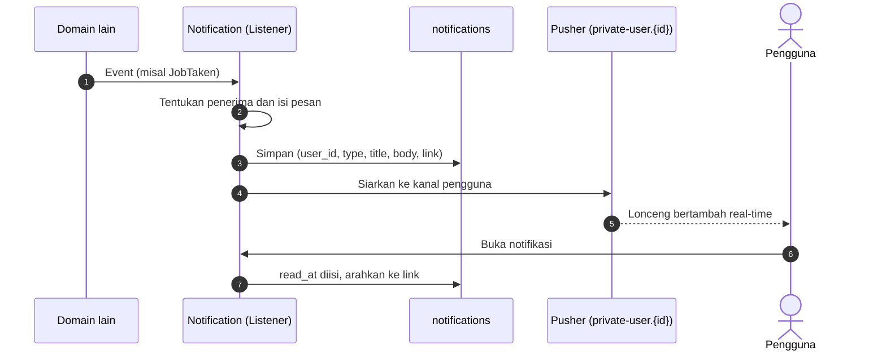

# Flow: Notification (NTF)

Prioritas P1. Referensi PRD: 13.15, 18.16. Hanya notifikasi dalam web (tanpa email, WhatsApp, atau push di luar web).

## Aktor

Semua pengguna login. Domain Notification hanya **mendengar event** domain lain.

## 1. Alur

## 2. Pemicu [USULAN, PRD 13.15]

| Penerima | Kejadian | Event sumber | Tautan |
| --- | --- | --- | --- |
| Inspektor | Job baru sesuai keahlian | `PaymentSucceeded` (inspection) | Detail job |
| Inspektor | Verifikasi disetujui atau ditolak | `InspectorApproved/Rejected` | Pengaturan akun |
| Penjual | Listing disetujui atau ditolak | `ListingApproved/Rejected` | Listing saya |
| Penjual | Job diambil, jadwal ditetapkan, hasil dikirim | `JobTaken`, `JobScheduled`, `ResultSubmitted` | Detail job |
| Penjual | Pengajuan beli | `TransactionOffered` | Transaksi |
| Pemohon inspeksi | Job diambil, jadwal, hasil dikirim, dibatalkan otomatis (D-01) | `JobTaken`, `JobScheduled`, `ResultSubmitted`, `JobCancelled` | Detail job |
| Pembeli | Pengajuan beli disetujui atau ditolak | `TransactionAccepted/Rejected` | Transaksi |
| Pembeli | Pembayaran dibuka setelah inspeksi selesai (D-02) | `JobCompleted` / `JobCancelled` | Transaksi |
| Admin | Listing atau inspektor baru menunggu | `ListingSubmitted`, `InspectorSubmitted` | Antrean |
| Peserta chat | Pesan baru | `MessageSent` | Percakapan |
| Pembayar | Pembayaran berhasil | `PaymentSucceeded` | Riwayat |
| Inspektor | Fee cair | `JobCompleted` | Pendapatan |

## 3. Aturan bisnis

| ID | Aturan |
| --- | --- |
| NTF-R1 | Notifikasi hanya dapat dibaca pemiliknya |
| NTF-R2 | Domain lain tidak memanggil Notification langsung, hanya memancarkan event |
| NTF-R3 | Penanda belum dibaca tampil di lonceng dan diperbarui real-time |
| NTF-R4 | Pesan chat beruntun dari percakapan yang sama dikelompokkan, bukan satu notifikasi per pesan [USULAN] |
| NTF-R5 | Notifikasi tidak memuat data persis (alamat, nomor rangka) |
| NTF-R6 | Pengguna diblokir tidak menerima notifikasi baru |
| NTF-R7 | Tandai satu atau semua sebagai dibaca |

## 4. Edge case

| ID | Situasi | Perilaku |
| --- | --- | --- |
| NTF-E1 | Pusher tidak tersedia | Notifikasi tetap tersimpan. UI memuat lewat polling |
| NTF-E2 | Event dipancarkan dua kali | Tidak ada notifikasi ganda (kunci unik per kejadian dan penerima) |
| NTF-E3 | Penerima tidak ditemukan (akun terhapus) | Dilewati tanpa error |
| NTF-E4 | Pengguna membuka notifikasi milik orang lain | 403 |
| NTF-E5 | Tautan tujuan sudah tidak berlaku (listing nonaktif) | Halaman tujuan menampilkan 404 ramah, notifikasi tetap dapat ditandai dibaca |
| NTF-E6 | Banyak notifikasi | Pagination dan daftar kosong ramah |
| NTF-E7 | Listener gagal | Tidak menggagalkan aksi utama (diantrekan, dicatat) |

## 5. Daftar test case

- [ ] `NTF-T01` Setiap event pada tabel pemicu membuat notifikasi untuk penerima yang tepat (dataset event × penerima)
- [ ] `NTF-T02` Event ganda tidak menghasilkan notifikasi ganda (NTF-E2)
- [ ] `NTF-T03` Hanya pemilik dapat membaca atau menandai (NTF-E4)
- [ ] `NTF-T04` Tandai dibaca satu dan semua
- [ ] `NTF-T05` Jumlah belum dibaca benar
- [ ] `NTF-T06` Siaran dikirim ke kanal pengguna yang benar
- [ ] `NTF-T07` Kegagalan listener tidak menggagalkan aksi utama (NTF-E7)
- [ ] `NTF-T08` Notifikasi tidak memuat alamat atau nomor rangka (NTF-R5)
- [ ] `NTF-T09` Pengguna diblokir tidak menerima notifikasi (NTF-R6)
- [ ] `NTF-T10` Pesan chat beruntun dikelompokkan (NTF-R4)
