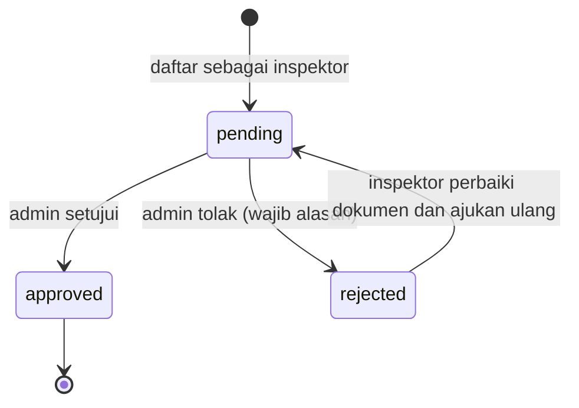
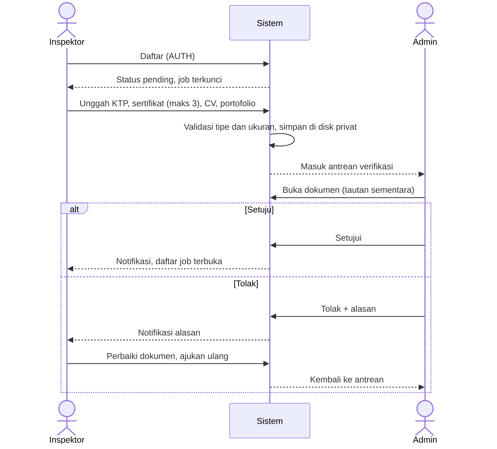

# Flow: Inspector Onboarding (ONB)

Prioritas P0. Referensi PRD: 12.1, 12.7, 13.1, 18.2, 18.3.

## Aktor

Inspektor, admin.

## 1. State machine verifikasi

## 2. Alur

## 3. Aturan bisnis

| ID | Aturan |
| --- | --- |
| ONB-R1 | Dokumen wajib: KTP (JPG/PNG/PDF, maks 2 MB), sertifikat (maks 3 berkas, 2 MB per berkas), CV (PDF, maks 2 MB), portofolio (berkas maks 2 MB atau URL) |
| ONB-R2 | Dokumen disimpan di disk privat. Hanya pemilik dan admin yang dapat membuka lewat tautan bertanda tangan sementara |
| ONB-R3 | Inspektor `pending` atau `rejected` tidak dapat melihat atau mengambil job |
| ONB-R4 | Penolakan wajib alasan. Persetujuan mencatat `verified_by` dan `verified_at` |
| ONB-R5 | Jenis keahlian (`car`, `motorcycle`) membatasi job yang tampil |
| ONB-R6 | Inspektor yang `approved` mengganti dokumen: status tetap `approved` dan perubahan dicatat [USULAN] |

## 4. Edge case

| ID | Situasi | Perilaku |
| --- | --- | --- |
| ONB-E1 | Berkas > 2 MB atau tipe tidak diizinkan | Ditolak dengan pesan jelas, berkas lain tidak hilang |
| ONB-E2 | Berkas dengan ekstensi benar tetapi isi bukan gambar/PDF | Ditolak (periksa MIME sebenarnya) |
| ONB-E3 | Pengguna lain membuka URL dokumen inspektor | 403, tautan sementara tidak bisa dipakai pihak lain |
| ONB-E4 | Inspektor `pending` mengakses `/jobs` | 403 |
| ONB-E5 | Ditolak lalu diajukan ulang tanpa memperbaiki | Diperbolehkan, status kembali `pending`, alasan lama tersimpan di riwayat |
| ONB-E6 | Dua admin menindaklanjuti pengajuan yang sama | Aksi kedua gagal karena status sudah berubah, tanpa efek ganda |
| ONB-E7 | Inspektor belum mengunggah semua dokumen wajib | Tidak masuk antrean admin, ditampilkan daftar yang kurang |
| ONB-E8 | Inspektor diblokir | Job aktifnya ditangani admin (AUTH-E7) |

## 5. Daftar test case

- [x] `ONB-T01` Unggah dokumen valid tersimpan di disk privat
- [x] `ONB-T02` Berkas terlalu besar atau tipe salah ditolak (ONB-E1, ONB-E2)
- [x] `ONB-T03` Inspektor tanpa dokumen lengkap tidak masuk antrean (ONB-E7)
- [ ] `ONB-T04` Admin menyetujui: status `approved`, `verified_by` dan `verified_at` terisi
- [ ] `ONB-T05` Admin menolak tanpa alasan gagal, dengan alasan berhasil
- [ ] `ONB-T06` Inspektor ditolak dapat mengajukan ulang, status kembali `pending` (ONB-E5)
- [x] `ONB-T07` Hanya pemilik dan admin yang dapat mengakses dokumen (ONB-E3), dataset role
- [ ] `ONB-T08` Inspektor `pending` mendapat 403 pada daftar job (ONB-E4)
- [x] `ONB-T09` Transisi status verifikasi: pasangan sah diterima, selain itu ditolak
- [ ] `ONB-T10` Aksi admin ganda pada pengajuan yang sama hanya berlaku sekali (ONB-E6)
- [ ] `ONB-T11` Job yang tampil sesuai jenis keahlian inspektor (ONB-R5)
