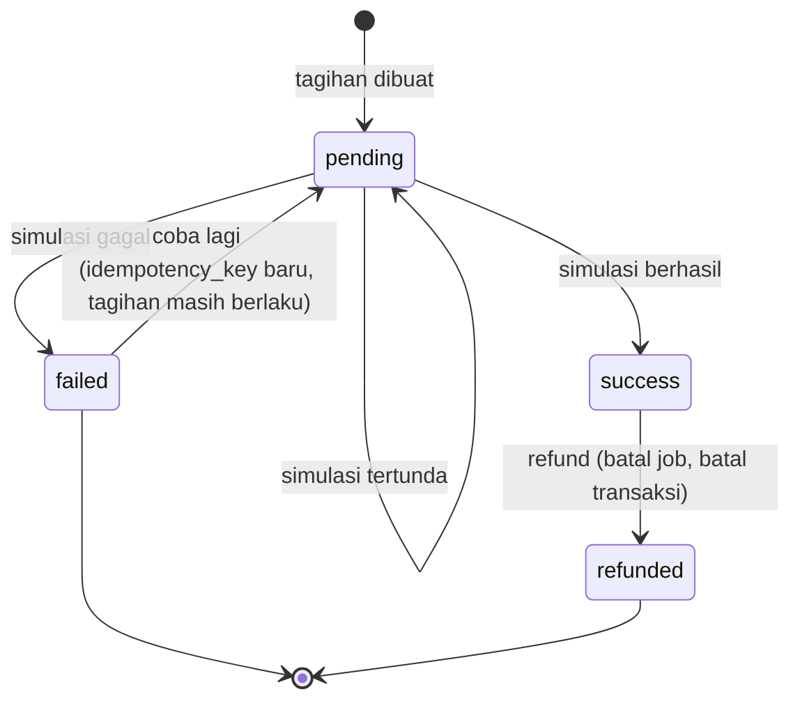
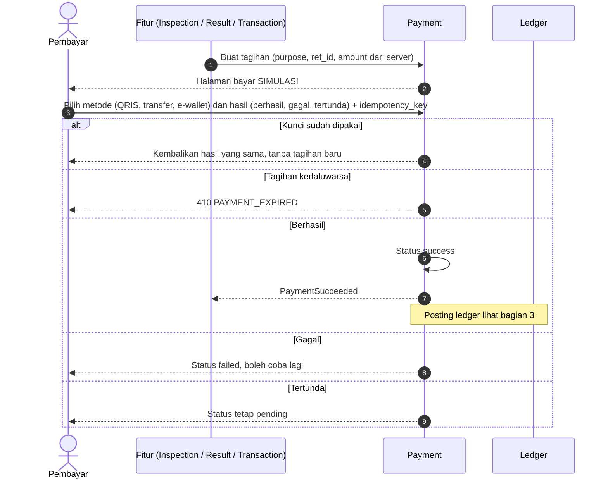

# Flow: Payment & Ledger (PAY)

Prioritas P0. Referensi PRD: 8.1, 8.4, 13.4, 13.9, 18.12, 19.5. Semua pembayaran adalah **simulasi**.

## Aktor

Pembayar (pemohon, pembeli, pengakses hasil), sistem, admin.

## 1. State machine pembayaran

Tagihan yang melewati `expires_at` tidak dapat dibayar (`410 PAYMENT_EXPIRED`).

## 2. Alur pembayaran simulasi

## 3. Posting ledger

| Tujuan | Kapan diposting | Entri |
| --- | --- | --- |
| `inspection` | Saat job `completed` (bukan saat bayar) | Kredit inspektor `inspection_fee` = amount − platform. Kredit platform `platform_fee` = round(amount × pct / 100) |
| `access` | Saat pembayaran akses `success` | Kredit inspektor `access_fee` dan platform `platform_fee` dengan rumus yang sama |
| `purchase` | Saat transaksi `completed` (P1) | Penjual menerima harga − komisi transaksi. Komisi 3% dibagi: inspektor `sale_commission` dan platform `platform_fee` (10% dari komisi) |
| Refund | Saat dibatalkan setelah bayar | Entri `refund` ke pembayar. Tidak ada entri kredit inspektor atau platform yang perlu dibalik karena belum diposting (untuk `inspection` dan `purchase`) |

Alasan posting `inspection` saat selesai: PRD 8.1 menyebut fee inspektor "cair setelah job selesai". Dengan begitu refund sebelum selesai tidak butuh entri pembalik.

### Contoh (pembulatan setengah ke atas, sisa ke penerima)

| Kasus | Pembayaran | Platform 10% | Inspektor |
| --- | --- | --- | --- |
| Inspeksi mobil | 50.000 | 5.000 | 45.000 |
| Akses motor | 15.000 | 1.500 | 13.500 |
| Tarif ganjil 15.005 (uji pembulatan) | 15.005 | 1.501 | 13.504 |
| Komisi transaksi Rp100.000.000 × 3% | 3.000.000 | 300.000 | 2.700.000 |

## 4. Aturan bisnis

| ID | Aturan |
| --- | --- |
| PAY-R1 | Jumlah tagihan dihitung **server** dari pengaturan yang tersalin pada job. Tidak pernah dari input klien |
| PAY-R2 | Setiap permintaan bayar punya `idempotency_key` unik. Kunci sama menghasilkan hasil yang sama |
| PAY-R3 | Hanya pemilik tagihan yang dapat membayar |
| PAY-R4 | Platform + penerima = nilai pembayaran, tanpa selisih (pembulatan di `Money::split`) |
| PAY-R5 | Tagihan inspeksi berlaku 30 menit. Tagihan akses dan beli [USULAN: 30 menit] |
| PAY-R6 | Operasi uang dalam `DB::transaction`. Tidak ada entri ledger setengah jadi |
| PAY-R7 | Refund hanya untuk pembayaran `success` yang belum selesai diposting, sekali saja |
| PAY-R8 | Saldo inspektor = jumlah entri kreditnya (tanpa penarikan nyata) |
| PAY-R9 | Halaman bayar diberi label SIMULASI. Mode `outcome` bebas hanya aktif di non-produksi atau lingkungan demo |
| PAY-R10 | Pembayaran gagal tidak mengubah status job. Job tetap `requested` |

## 5. Edge case

| ID | Situasi | Perilaku |
| --- | --- | --- |
| PAY-E1 | Klik ganda atau muat ulang halaman | Idempotency key mencegah tagihan ganda |
| PAY-E2 | Pembayaran gagal atau tertunda | Job tetap `requested`, pengguna dapat mencoba lagi sampai kedaluwarsa |
| PAY-E3 | Pembayaran akses dibuka dua kali | Tidak ada tagihan kedua, akses yang ada dipakai |
| PAY-E4 | Tagihan kedaluwarsa lalu dibayar | `410 PAYMENT_EXPIRED`, pemohon mengajukan ulang |
| PAY-E5 | Pengguna lain membayar tagihan milik orang lain | 403 |
| PAY-E6 | Nominal dimanipulasi di request | Diabaikan, server memakai nilainya sendiri |
| PAY-E7 | Refund dipanggil dua kali | Efek sekali |
| PAY-E8 | Tarif diubah admin setelah tagihan dibuat | Tagihan memakai tarif lama |
| PAY-E9 | Tarif ganjil sehingga komisi berpecahan | Pembulatan setengah ke atas, jumlah tetap sama |
| PAY-E10 | Pembayaran sukses tetapi listener gagal | Dalam transaksi yang sama atau dapat diulang aman (idempoten), tanpa kondisi setengah jadi |
| PAY-E11 | Simulasi `pending` lalu `success` | Diperbolehkan, tagihan masih berlaku |

## 6. Daftar test case

- [x] `PAY-T01` Tagihan dibuat dengan jumlah dari server (PAY-E6)
- [x] `PAY-T02` `Money::split` menjumlah ke nilai awal untuk banyak nilai (dataset termasuk ganjil, PAY-E9)
- [x] `PAY-T03` Idempotency: dua permintaan kunci sama menghasilkan satu pembayaran (PAY-E1)
- [x] `PAY-T04` Hasil `success`, `failed`, `pending` mengubah status sesuai transisi (dataset)
- [x] `PAY-T05` Gagal tidak mengubah job, boleh coba lagi dengan kunci baru (PAY-E2)
- [x] `PAY-T06` Tagihan kedaluwarsa menghasilkan 410 (PAY-E4)
- [x] `PAY-T07` Pembayar lain mendapat 403 (PAY-E5)
- [ ] `PAY-T08` Posting ledger akses: inspektor dan platform sesuai persen (contoh tabel)
- [ ] `PAY-T09` Posting ledger inspeksi hanya saat job `completed`
- [ ] `PAY-T10` Refund sebelum selesai menghasilkan satu entri `refund`, idempoten (PAY-E7)
- [ ] `PAY-T11` Perubahan tarif tidak memengaruhi tagihan atau job lama (PAY-E8)
- [ ] `PAY-T12` Saldo inspektor sama dengan jumlah kreditnya (PAY-R8)
- [ ] `PAY-T13` Invarian ledger: total entri per pembayaran = nilai pembayaran, di semua jalur (dataset tujuan)
- [x] `PAY-T14` Transaksi database: kegagalan di tengah tidak meninggalkan entri parsial (PAY-E10)
- [ ] `PAY-T15` Akses hasil tidak membuat tagihan kedua bila sudah punya akses (PAY-E3)
