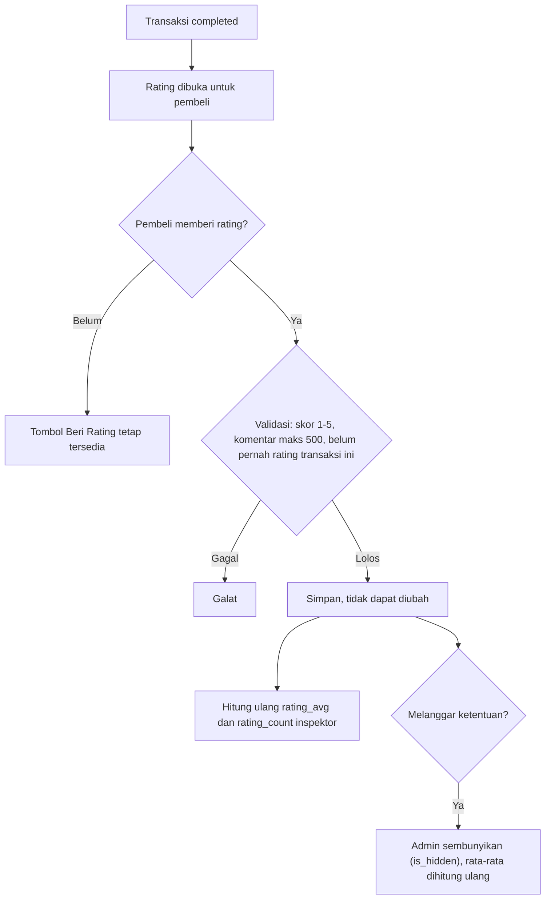

# Flow: Rating (RTG)

Prioritas P1. Referensi PRD: 8.7, 13.14, 18.15, R8.

## Aktor

Pembeli (transaksi selesai), admin, inspektor (penerima).

## 1. Alur

## 2. Aturan bisnis

| ID | Aturan |
| --- | --- |
| RTG-R1 | Hanya pembeli dari transaksi `completed` yang dapat memberi rating, satu kali per transaksi |
| RTG-R2 | Skor 1–5, komentar opsional maks 500 karakter |
| RTG-R3 | Rating tidak dapat diubah atau dihapus pembeli |
| RTG-R4 | Penerima adalah inspektor pembuat hasil inspeksi yang berlaku saat transaksi (TRX-R3) |
| RTG-R5 | Transaksi pada listing tanpa hasil inspeksi tidak dapat dirating (tidak ada inspektor) |
| RTG-R6 | `rating_avg` dan `rating_count` dihitung dari rating yang tidak disembunyikan |
| RTG-R7 | Admin dapat menyembunyikan dan menampilkan kembali rating, tercatat |
| RTG-R8 | Rating tampil pada hasil inspeksi dan dashboard inspektor |
| RTG-R9 | Rating oleh pemohon inspeksi setelah menerima hasil [OPEN, Q10, R8]. Belum dikerjakan |

## 3. Edge case

| ID | Situasi | Perilaku |
| --- | --- | --- |
| RTG-E1 | Rating dua kali untuk transaksi yang sama | Ditolak (batasan unik pada `transaction_id`) |
| RTG-E2 | Rating sebelum transaksi selesai | Ditolak |
| RTG-E3 | Bukan pembeli transaksi itu | 403 |
| RTG-E4 | Skor di luar 1–5 | Validasi gagal |
| RTG-E5 | Komentar > 500 karakter atau berisi HTML | Validasi gagal, HTML di-*escape* |
| RTG-E6 | Admin menyembunyikan rating | Rata-rata dan jumlah dihitung ulang tanpa rating itu |
| RTG-E7 | Transaksi tanpa inspeksi | Tidak ada rating (RTG-R5) |
| RTG-E8 | Inspektor yang ratingnya banyak | Rata-rata dibulatkan 2 desimal (`numeric(3,2)`) |
| RTG-E9 | Dua rating bersamaan untuk inspektor yang sama | Rata-rata tetap benar (dihitung dari sumber, bukan penambahan buta) |

## 4. Daftar test case

- [ ] `RTG-T01` Pembeli transaksi selesai memberi rating dan tersimpan
- [ ] `RTG-T02` Ditolak: sebelum selesai, bukan pembeli, ganda, tanpa inspeksi (dataset RTG-E1, E2, E3, E7)
- [ ] `RTG-T03` Validasi skor dan komentar (RTG-E4, RTG-E5)
- [ ] `RTG-T04` Rata-rata dan jumlah diperbarui benar, pembulatan 2 desimal
- [ ] `RTG-T05` Admin menyembunyikan dan menampilkan, rata-rata dihitung ulang (RTG-E6)
- [ ] `RTG-T06` Rating tidak dapat diubah atau dihapus pembeli (RTG-R3)
- [ ] `RTG-T07` Rating tampil di hasil inspeksi dan dashboard inspektor
- [ ] `RTG-T08` Penghitungan ulang konsisten pada rating bersamaan (RTG-E9)
