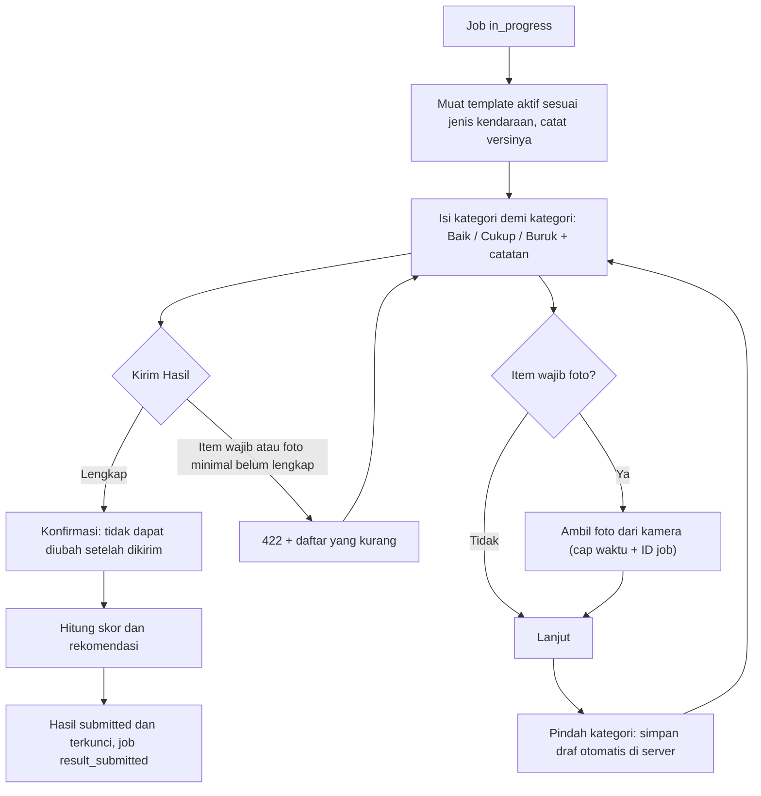
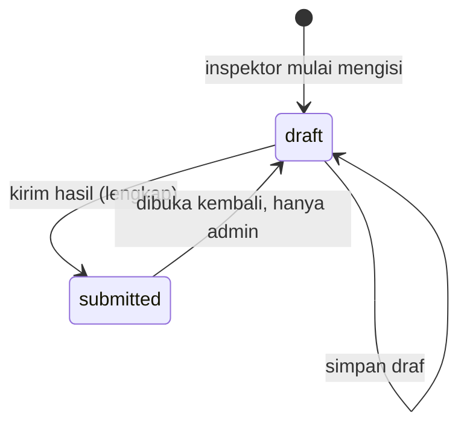
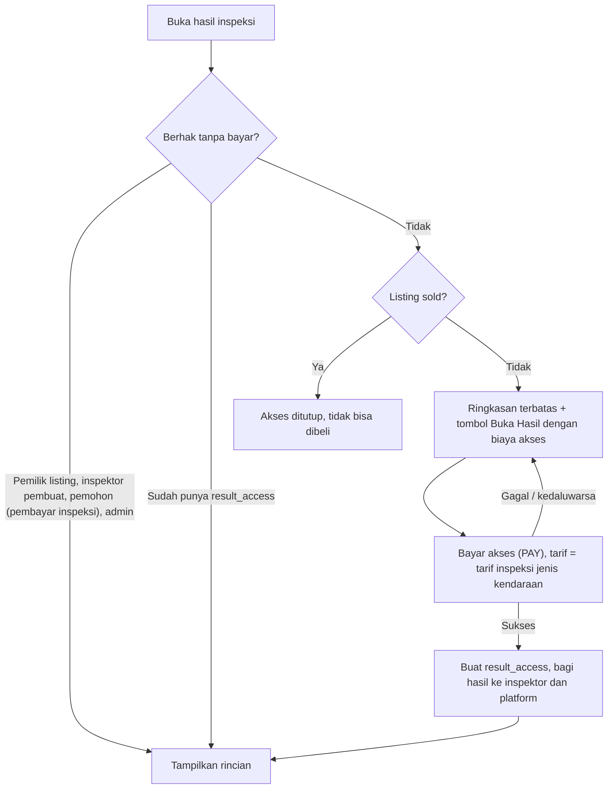

# Flow: Inspection Result (RES)

Prioritas P0. Referensi PRD: 8.2, 12.4, 13.6, 13.7, 15, 16.2, 18.8–18.11, 19.7–19.9.

## Aktor

Inspektor (mengisi), pemohon, pemilik listing, pembeli lain (akses berbayar), admin.

## 1. Mengisi hasil

## 2. State hasil

## 3. Akses hasil

## 4. Skor dan rekomendasi [PRD 15.3, USULAN]

- Nilai item: Baik = 2, Cukup = 1, Buruk = 0, dikali **bobot** item.
- Skor total = (jumlah nilai berbobot ÷ nilai maksimum berbobot) × 100.

| Skor | Rekomendasi |
| --- | --- |
| ≥ 80 | Layak (`recommended`) |
| 60 – 79 | Perlu Perhatian (`caution`) |
| < 60 | Tidak Direkomendasikan (`not_recommended`) |

**Item kritis** berstatus Buruk membuat rekomendasi otomatis `not_recommended`, berapa pun skornya.

Contoh: 4 item bobot 1 (maks 8). Nilai Baik, Baik, Cukup, Buruk = 2 + 2 + 1 + 0 = 5, skor 62,5, rekomendasi `caution`.

## 5. Aturan bisnis

| ID | Aturan |
| --- | --- |
| RES-R1 | Form dibuat dari **template** per jenis kendaraan. Versi template tercatat pada hasil |
| RES-R2 | Draf tersimpan di server setiap pindah kategori. Hanya inspektor pemilik job yang dapat membaca dan mengubah |
| RES-R3 | Kirim Hasil aktif hanya bila semua item wajib terisi dan foto minimal terpenuhi |
| RES-R4 | Setelah dikirim, hasil terkunci. Hanya admin yang dapat membuka kembali |
| RES-R5 | Foto inspeksi hanya dari kamera. Foto galeri ditolak (`422 NOT_CAMERA_CAPTURE`) |
| RES-R6 | Foto menyimpan `captured_at` (waktu server) dan `stamped_at` (waktu tertanam). Waktu server menjadi acuan |
| RES-R7 | Foto dan dokumen di disk privat, ditampilkan lewat tautan bertanda tangan sementara |
| RES-R8 | Tanpa hak akses, hanya ringkasan terbatas: lencana, tanggal, nama dan rating inspektor, biaya akses. Skor opsional [OPEN, Q11] |
| RES-R9 | Biaya akses = tarif inspeksi jenis kendaraan itu. Akses berlaku selama listing belum `sold` |
| RES-R10 | Satu `result_access` per (hasil, pengguna). Membuka dua kali tidak menagih lagi |
| RES-R11 | Setelah listing `sold`, pembeli baru tidak dapat membuka. Riwayat pembayar tetap |
| RES-R12 | Tidak ada tombol unduh atau cetak |
| RES-R13 | Hasil mengacu pada inspeksi terbaru yang berlaku. Perubahan field inti (D-05) mencabut lencana tetapi tidak menghapus hasil lama dari riwayat pembayar |

## 6. Edge case

| ID | Situasi | Perilaku |
| --- | --- | --- |
| RES-E1 | Foto > 2 MB atau bukan gambar | Dikompresi otomatis. Bila tetap gagal, galat jelas |
| RES-E2 | Izin kamera ditolak | Petunjuk mengaktifkan izin. Kirim tidak dapat dilanjutkan tanpa foto wajib |
| RES-E3 | Koneksi putus saat mengisi | Draf aman di server, pesan "koneksi terputus, mencoba lagi" |
| RES-E4 | Sesi berakhir saat mengisi | Masuk ulang, draf dipulihkan |
| RES-E5 | Foto dari galeri | Ditolak `NOT_CAMERA_CAPTURE` |
| RES-E6 | Kirim Hasil ditekan dua kali | Efek sekali |
| RES-E7 | Membuka akses dua kali | Tidak ada tagihan kedua |
| RES-E8 | Listing terjual setelah pembeli membayar akses | Pembeli itu tetap melihat di riwayatnya, pembeli lain tidak dapat membuka |
| RES-E9 | Item kritis Buruk dengan skor tinggi | Rekomendasi tetap `not_recommended` |
| RES-E10 | Template berubah saat draf berjalan | Draf tetap memakai versi template yang tercatat |
| RES-E11 | Inspektor lain mengakses draf | 403 |
| RES-E12 | Pembeli yang belum bayar membuka URL hasil | Ringkasan terbatas, bukan rincian |
| RES-E13 | Inspeksi ulang sesudah lencana dicabut | Hasil baru menggantikan lencana. Hasil lama tetap di riwayat pembayar |
| RES-E14 | Admin membuka kembali hasil terkunci | Status `draft`, dicatat, inspektor dinotifikasi |

## 7. Daftar test case

- [x] `RES-T01` Template mobil dan motor berbeda tampil sesuai jenis kendaraan
- [x] `RES-T02` Simpan draf dan lanjutkan setelah muat ulang (RES-E3)
- [x] `RES-T03` Kirim ditolak bila item wajib atau foto minimal kurang, dengan daftar yang kurang (`REQUIRED_ITEMS_MISSING`, `MIN_PHOTOS_NOT_MET`)
- [x] `RES-T04` Foto non-kamera ditolak (RES-E5), foto kamera diterima dan bercap waktu
- [x] `RES-T05` Berkas > 2 MB atau bukan gambar ditolak (RES-E1)
- [x] `RES-T06` Perhitungan skor (dataset: batas 79/80, 59/60, contoh 62,5)
- [x] `RES-T07` Item kritis Buruk memaksa `not_recommended` (RES-E9)
- [x] `RES-T08` Hasil terkunci setelah dikirim, ubah ditolak, admin dapat membuka kembali (RES-E14)
- [x] `RES-T09` Kirim dua kali berefek sekali (RES-E6)
- [x] `RES-T10` Hak akses tanpa bayar: pemilik, inspektor pembuat, pemohon, admin (dataset)
- [x] `RES-T11` Pengguna lain mendapat ringkasan terbatas tanpa rincian (RES-E12), respons tidak memuat rincian
- [x] `RES-T12` Bayar akses membuat `result_access` dan posting ledger, tidak menagih dua kali (RES-E7)
- [x] `RES-T13` Setelah `sold`, pembeli baru tidak dapat membuka, pembayar lama tetap (RES-E8)
- [x] `RES-T14` Draf hanya dapat diakses inspektor pemilik job (RES-E11)
- [x] `RES-T15` Draf tetap memakai versi template yang tercatat (RES-E10)
- [x] `RES-T16` Tautan foto bertanda tangan kedaluwarsa dan tidak dapat dipakai pihak lain
- [x] `RES-T17` Tidak ada rute unduh atau cetak (RES-R12)

