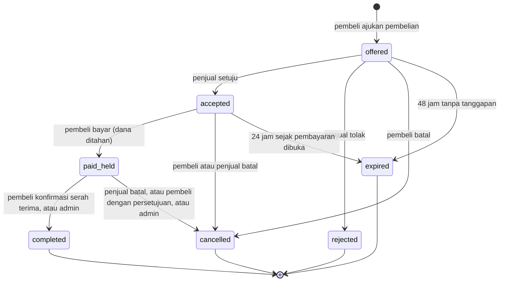
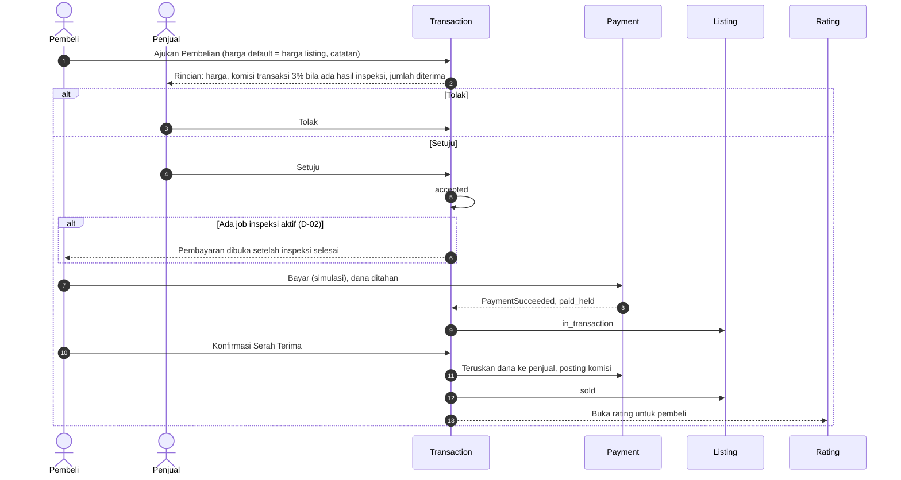

# Flow: Transaction (TRX)

Prioritas P1. Referensi PRD: 8.6, 12.5, 13.12, 14.3, 18.13. Keputusan: D-02, D-04.

## Aktor

Pembeli, penjual, admin, sistem (terjadwal).

## 1. State machine

Satu listing hanya boleh punya satu transaksi berjalan (`offered`, `accepted`, `paid_held`).

## 2. Alur utama

## 3. Perhitungan (listing berhasil diinspeksi)

| Komponen | Rumus | Contoh harga Rp100.000.000 |
| --- | --- | --- |
| Komisi transaksi | harga × 3% | 3.000.000 |
| Komisi platform atas komisi | komisi × 10% [OPEN, Q5] | 300.000 |
| Diterima inspektor | komisi − bagian platform | 2.700.000 |
| Diterima penjual | harga − komisi transaksi [OPEN, Q5] | 97.000.000 |
| Dibayar pembeli | harga | 100.000.000 |

Tanpa hasil inspeksi, tidak ada komisi (E23 PRD): penjual menerima harga penuh.
Penerima komisi: inspektor pembuat hasil inspeksi terbaru yang berlaku [OPEN, Q7].

## 4. Aturan bisnis

| ID | Aturan |
| --- | --- |
| TRX-R1 | Hanya listing milik orang lain berstatus `active` atau `in_inspection` yang dapat ditawar (D-02) |
| TRX-R2 | Satu transaksi berjalan per listing, dijaga Action dan batasan unik |
| TRX-R3 | Harga tawaran, persen komisi, dan inspektor penerima disalin saat penawaran dibuat |
| TRX-R4 | Penjual melihat rincian potongan sebelum menekan Setuju atau Tolak |
| TRX-R5 | Pembayaran dibuka hanya bila tidak ada job inspeksi aktif pada listing (D-02) |
| TRX-R6 | Pembayaran memakai modul simulasi dan idempotency key yang sama dengan PAY |
| TRX-R7 | Dana `paid_held` diteruskan hanya saat serah terima dikonfirmasi pembeli atau admin |
| TRX-R8 | Pembatalan dan refund mengikuti tabel D-04. Komisi inspektor tidak dibayar bila batal |
| TRX-R9 | Kedaluwarsa: `offered` 48 jam, `accepted` 24 jam sejak pembayaran dibuka [USULAN]. `paid_held` 7 hari ditandai perlu tindakan untuk admin |
| TRX-R10 | Pembeli tidak dapat membeli listing sendiri (E18 PRD). Inspektor tidak dapat membeli (D-06) |
| TRX-R11 | Setelah `completed`: listing `sold`, akses hasil baru ditutup, rating dibuka |

## 5. Pembatalan

Lihat tabel lengkap di [decisions/0002-flow-decisions.md](../decisions/0002-flow-decisions.md#d-04-pembatalan-transaksi).

## 6. Edge case

| ID | Situasi | Perilaku |
| --- | --- | --- |
| TRX-E1 | Ajukan beli listing sendiri | Ditolak |
| TRX-E2 | Dua pembeli mengajukan bersamaan | Satu berhasil, yang lain `409` (transaksi sudah berjalan) |
| TRX-E3 | Penjual mengubah harga setelah penawaran | Penawaran memakai harga tersalin |
| TRX-E4 | Penawaran disetujui saat inspeksi berjalan | Status `accepted`, tombol Bayar menunggu job selesai dengan pesan jelas |
| TRX-E5 | Job inspeksi dibatalkan atau selesai saat transaksi `accepted` | Pembayaran dibuka, penghitung 24 jam mulai |
| TRX-E6 | Bayar dua kali atau klik ganda | Idempotency, satu pembayaran |
| TRX-E7 | Penawaran `offered` melewati 48 jam | `expired`, listing bebas |
| TRX-E8 | Penjual membatalkan setelah `paid_held` | Refund 100% ke pembeli, dicatat untuk tinjauan admin |
| TRX-E9 | Pembeli meminta batal setelah `paid_held` | Perlu persetujuan penjual atau admin |
| TRX-E10 | Serah terima tidak dikonfirmasi 7 hari | Ditandai perlu tindakan, admin memutuskan |
| TRX-E11 | Listing tanpa hasil inspeksi | Tidak ada komisi inspektor (E23 PRD) |
| TRX-E12 | Pihak diblokir saat transaksi berjalan | Admin menyelesaikan atau membatalkan (AUTH-E7) |
| TRX-E13 | Serah terima dikonfirmasi dua kali | Efek sekali |
| TRX-E14 | Penjual mencoba mengubah field inti listing saat ada transaksi berjalan | Ditolak (LST-R7), lencana tidak dicabut selama transaksi berjalan |

## 7. Daftar test case

- [ ] `TRX-T01` Pembeli mengajukan beli pada listing `active` dan `in_inspection` (dataset status), ditolak pada status lain
- [ ] `TRX-T02` Beli listing sendiri ditolak (TRX-E1), inspektor ditolak
- [ ] `TRX-T03` Hanya satu transaksi berjalan per listing (TRX-E2)
- [ ] `TRX-T04` Rincian penjual: dengan inspeksi (komisi 3%, 10% atas komisi) dan tanpa inspeksi (TRX-E11)
- [ ] `TRX-T05` Harga, persen, dan inspektor tersalin dan tidak berubah saat pengaturan atau harga listing berubah (TRX-E3)
- [ ] `TRX-T06` Penjual setuju atau tolak, hanya penjual yang berhak
- [ ] `TRX-T07` Bayar ditunda saat ada job aktif, terbuka setelah job final (TRX-E4, TRX-E5)
- [ ] `TRX-T08` Bayar idempoten, dana `paid_held`, listing `in_transaction` (TRX-E6)
- [ ] `TRX-T09` Serah terima: dana diteruskan, ledger benar, listing `sold`, akses hasil ditutup, rating dibuka
- [ ] `TRX-T10` Pembatalan per kondisi D-04 (dataset kondisi × pelaku), refund dan listing sesuai
- [ ] `TRX-T11` Kedaluwarsa `offered` 48 jam dan `accepted` 24 jam (batas ±1 menit), idempoten
- [ ] `TRX-T12` `paid_held` 7 hari ditandai perlu tindakan, tidak otomatis diselesaikan (TRX-E10)
- [ ] `TRX-T13` Transisi status: pasangan sah diterima, selain itu ditolak
- [ ] `TRX-T14` Aksi role tidak berhak mendapat 403 (dataset)
- [ ] `TRX-T15` Konfirmasi serah terima ganda berefek sekali (TRX-E13)
- [ ] `TRX-T16` Invarian ledger: harga pembeli = diterima penjual + komisi inspektor + bagian platform
